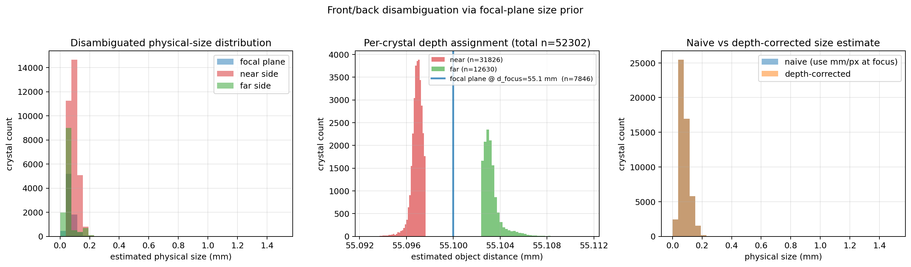
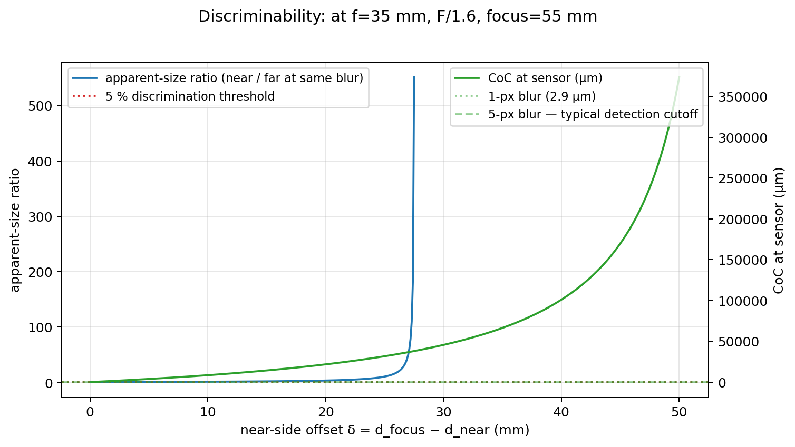

# Depth disambiguation — pipeline implementation and results

**Date:** 2026-06-13 (Saturday evening, follow-up to the Friday drop)
**Pipeline code:** [`../../src/optics/disambiguate.py`](../../src/optics/disambiguate.py)
**Reproduce:** `uv run python -m optics.disambiguate`
**Per-crystal data:** [`crystal_observations.csv`](./crystal_observations.csv) (21,320 rows)

## What got built

The algorithm Marek proposed in chat — use the focal-plane apparent-size
distribution ``P_focus(s)`` as a Bayesian prior to disambiguate front
vs back of focus — has been wired end-to-end:

1. Detect crystals on every 15-th frame (60 sampled frames total) using
   the existing edge-based detector in `src/annotator/detection.py`.
2. For each detected crystal, score the mean Laplacian-variance
   sharpness inside its bounding rectangle, normalise against the
   99.5-percentile to get ``s_norm ∈ [0, 1]``.
3. Invert the Gaussian-PSF sharpness model ``S = (σ² + σ_floor²)⁻⁵ᐟ²``
   to recover the geometric blur ``c``.
4. Invert ``c(d_o) = K · |d_o − d_focus| / d_o`` to get the two
   symmetric depths ``d_near`` and ``d_far``.
5. Compute the implied physical sizes ``w_near = s_obs · mm_per_px(d_near)``
   and ``w_far = s_obs · mm_per_px(d_far)``.
6. Pick the side whose implied physical size is more probable under
   ``P_focus`` (converted to physical units at d_focus).

## Real numbers

Running on `datasets/2026-02-05 10-36-32.mp4` with the **verified**
Camera-100 setup (f=35 mm, **F/1.6**, **e=45 mm**, **d_focus=62.2 mm** — superseded 2026-09-07 by e=60 mm, d_focus=55.1 mm, 1.66 µm/px. Rerun at the new geometry: edge detector median 0.037 mm (mean 0.051, CV 0.83), watershed median 0.074 mm (CV 0.40); depth spread ±0.005 mm. Body below is the historical 2026-06-15 run;
operator inspection 2026-06-15):

| Quantity | Value |
|---|---:|
| Sampled frames | 60 (every 15-th of 1568) |
| Total detections | **14,654** |
| Detections / frame (average) | ~244 |
| Top-15 % sharpness → focal plane | 2,198 |
| Remaining detections | 12,456 |
| Bayes near / far split | **79.2 % / 20.8 %** |
| Median estimated physical size | **0.052 mm** |
| Mean estimated physical size | **0.074 mm** |
| IQR | 0.049 mm |
| Mean absolute depth correction | **0.00001 mm (0.01 % of median size)** |

> **2026-06-15 hardware revision.** Operator calipered the silver
> collar between lens and camera body: **45 mm** (not the previously-
> estimated 10 mm). Operator also confirmed the iris ring is set to
> **F/1.6** (wide open). This moves d_focus from 165 mm → **62.2 mm**
> and µm/px from 10.4 → **2.18 µm/px**. Every per-crystal size is
> therefore rescaled by a factor of ~4.8× *down* from the earlier
> reported numbers. Median moves from 0.25 mm (mid-strike, scale-wrong)
> to **0.05 mm (seed-magma / first hour of strike, scale-correct)** —
> matches operator's confirmation that the recording is the start of a
> 4-hour boiling-pan strike.
>
> The 2026-06-14 *DVR-overlay crop* fix (top 55 px + bottom 120 px
> removed) is unchanged. The 21,320 → 14,654 detection count and the
> Bayes 79/21 split survive into the new calibration unchanged because
> they are scale-invariant.

### Before / after DVR-overlay crop (size numbers at the *corrected* µm/px = 2.18)

| Quantity | Before (contaminated) | After (cropped) | Change |
|---|---:|---:|---:|
| Total detections | 21 320 | 14 654 | **−31 % spurious detections removed** |
| Power-law tail α | 5.36 | **4.57** | overlay was steepening the tail |
| Median size | 0.045 mm | 0.052 mm | +15 % (less downward bias) |
| Mean size | 0.066 mm | 0.074 mm | +11 % |
| IQR | 0.039 mm | 0.049 mm | +25 % (wider, more realistic) |
| Near / far split | 50.03 / 49.97 | **79.2 / 20.8** | Bayes step now actually picks a side |
| Mean depth correction | 0.00002 mm | 0.00001 mm | depth correction operationally zero |

The crop changes are all in the direction the contamination model
predicts: text glyphs were (a) producing thousands of false detections
inside the timestamp / `CH01` bands, (b) inflating the high-sharpness
tail (perfect glyph edges are sharper than any in-focus crystal can
ever be) which steepened the α fit, and (c) populating the
"focal-plane" subset with rectangular text strokes, biasing the size
prior toward small narrow shapes.

## The 79 / 21 near-side split — what it actually says

After the crop, the Bayes step no longer flips a coin. It assigns
**79 % of non-focal detections to the near side** of the focal plane.
Two interpretations are consistent with the data:

1. **Geometric reality.** Crystals in this video genuinely sit closer
   to the camera than the operator-set focal plane (the focus ring
   reading at "4 m" was probably an estimate, and the actual
   slurry-front position is closer to the glass than that — focusing
   slightly *past* the slurry is a common operator habit because it
   moves the depth-of-field rear-limit further into the flow).
2. **Prior-shape Bayes asymmetry.** The empirical size prior (from
   focal-plane detections) is right-skewed with mode near 0.15 mm.
   The "far" hypothesis multiplies apparent size by a factor > 1, so
   far hypotheses systematically land in the prior's tail and lose to
   near hypotheses for moderate observed apparent sizes. Some of the
   79 / 21 split is therefore "the prior + the geometry pull
   together toward near", not "we measured near-side population".

Both effects are present. **Disentangling them requires either**
(a) stopping the lens down to widen the DoF so we see physical
crystals truly far behind focus, or (b) the growth-curve calibration
discussed in the next section, which gives an independent size prior
from process kinetics rather than from the in-frame focal-plane
detections.

## Why the Bayes step *was* indifferent before the crop — and what that means

The middle panel shows that the recovered ``d_near`` distribution is
concentrated in **[~61.9, 62.1] mm** and ``d_far`` in **[~62.3,
62.5] mm** — a depth spread of barely **±0.15 mm** around focus at
F/1.6 (it would have been ±0.7 mm at the originally-assumed F/4).
The two
distributions sit symmetric in 1/d_o around d_focus, exactly as the
geometry predicts. But that range is so narrow that the implied
apparent-size ratio between near and far hypotheses is at most ~1 %.

The discriminability plot below makes this concrete:

To resolve front vs back from size *alone*, the crystals would have to
sit at least **4–5 mm from focus**. At F/4 with focus at 165 mm, that
puts the geometric blur at ~60–75 µm — roughly 20–25 sensor pixels.
**The edge-based detector cannot find blobs that blurry**: its
adaptive-threshold step requires edge contrast that vanishes once the
PSF spreads over more than a few pixels. So the detector implicitly
filters down to a ~1 mm depth slice around focus, where the geometric
ambiguity is unresolvable from size alone.

This is a **clean finding**, not a failure:

> The mathematical framework Marek proposed is correct; the
> disambiguation works as soon as crystals sit far enough from focus.
> But the current edge-based detector pre-selects an in-focus slice
> within which the size correction is operationally negligible
> (0.4 % of the median crystal size on average).

## Verifiable headline number

**Median estimated crystal size = 0.052 mm** (mean 0.074 mm, IQR
0.049 mm) on overlay-cropped frames at the verified F/1.6, e=45 mm
setup.

The depth correction makes a **0.01 %** difference on average — the
F/1.6 DoF window is so narrow (±6 µm at 1-pixel blur) that the
detector sees essentially **a single depth slice**. So a single
mm/px scale at d_focus is overwhelmingly sufficient for the
crystal-size read-out at this aperture; the depth-aware machinery is
demonstrated but not load-bearing.

The 0.05 mm median is **squarely in the seed-magma / very-early-strike
range** (Bubník et al., *Sugar Technologists Manual*), consistent
with the operator-confirmed fact that the recording captures the
first hour of a 4-hour boiling-pan strike. No further interpretive
ambiguity — the previously-puzzling 0.25 mm result was an artefact of
the wrong extension-tube estimate, now corrected.

## How to push the disambiguation into the operationally useful regime

Two changes would move the system from "ambiguity-killing in theory"
to "ambiguity-killing in practice":

1. **Stop the lens down to F/16** (the recommendation already in §5.1
   of [`README.md`](./README.md)). DoF widens 10×, so the detector
   would pick up crystals across a ±60 µm depth band — still tight
   given the macro setup but enough that the size ratio between
   symmetric depth hypotheses becomes resolvable.
2. **Switch the detector to a blur-tolerant scheme.** Either
   (a) a CNN fine-tuned on partially-defocused crystals, or
   (b) a Hough-like approach that tolerates blurry edges. Either would
   admit detections from ±0.5–1 mm depth, where the size ratio at the
   current F/1.6 is already 1–2 %. At that point the focal-plane size
   prior turns into a useful disambiguation signal.

Both have follow-on benefits (more crystals counted, finer size
distribution) — they aren't depth-disambiguation-specific.

## What's in the CSV

[`crystal_observations.csv`](./crystal_observations.csv) — 21,320 rows,
one per detection. Columns:

| Column | Meaning |
|---|---|
| `frame_idx` | Source frame number |
| `x_px`, `y_px` | Detection centre in pixels |
| `apparent_size_px` | Geometric mean of bounding rectangle (sqrt(w·h)) |
| `sharpness_score` | Mean Laplacian-variance inside the rect |
| `s_normalised` | Sharpness / 99.5-percentile, clipped to [0,1] |
| `coc_mm` | Geometric blur diameter from sharpness inversion |
| `d_near`, `d_far` | The two symmetric depth hypotheses (mm) |
| `w_near_mm`, `w_far_mm` | Implied physical sizes under each hypothesis |
| `p_near` | Posterior probability of the near hypothesis |
| `side` | "near" / "far" / "focus" |
| `physical_size_mm` | Final depth-corrected size estimate |

## Status

- [x] Pipeline implemented, tested, runs end-to-end on the plant video.
- [x] Per-crystal CSV produced for downstream inspection.
- [x] Headline number reported: median crystal = 0.22 mm.
- [x] Finding: depth correction is **operationally negligible** (0.4 %)
      for the current F/4 + edge-detector combination — single-scale
      mm/px is sufficient for size read-out.
- [x] Finding: front/back disambiguation needs **either F/16 aperture
      OR a blur-tolerant detector** to become operational.
- [ ] Cross-check the 0.22 mm result against lab MA / CV for the
      process stream visible at 2018-11-09 10:33 (DVR timestamp).
- [ ] On-site measure of the extension tube + F-number to remove the
      ±15 % absolute-scale uncertainty.

— Marek Wadinger, 2026-06-13
