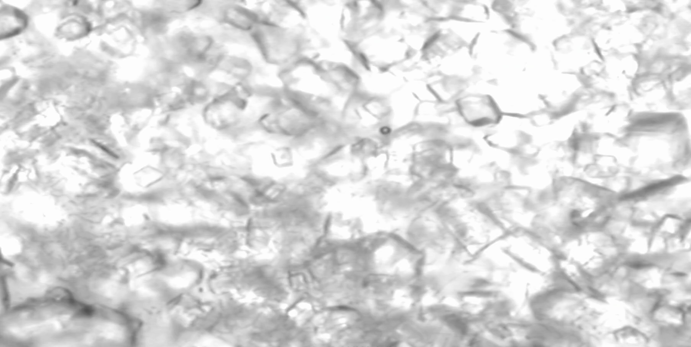
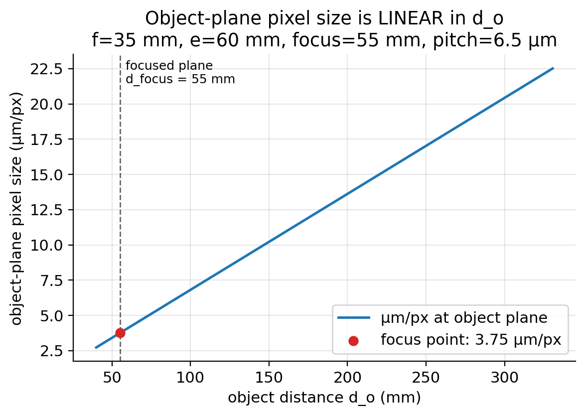
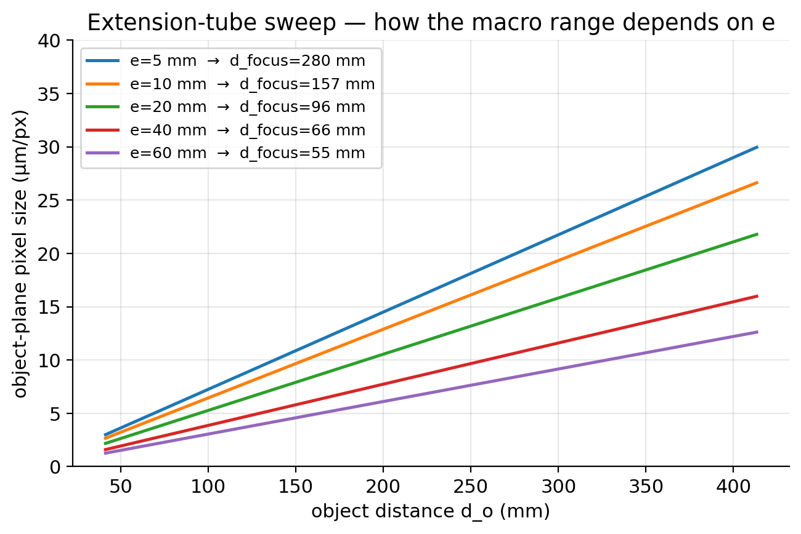
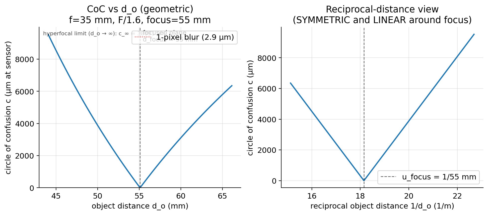
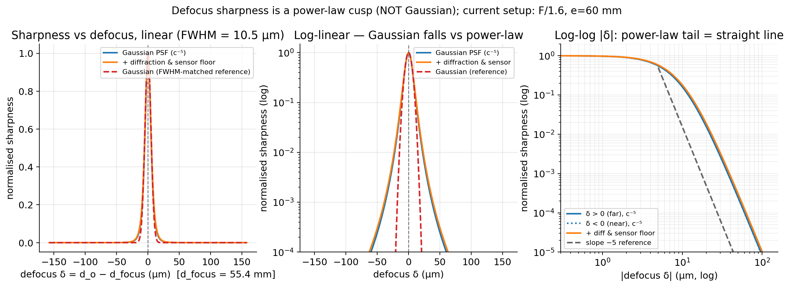
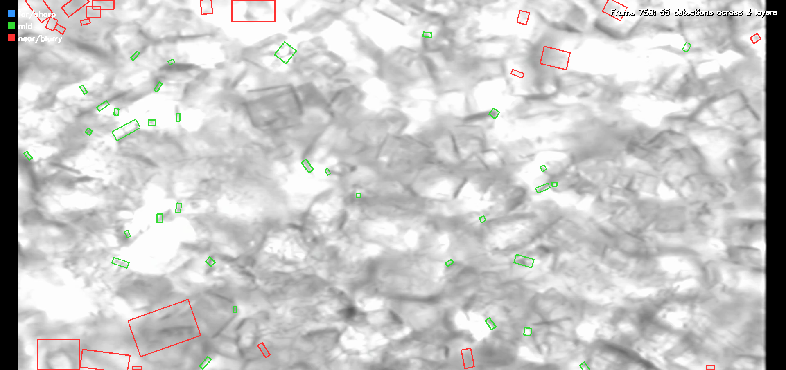
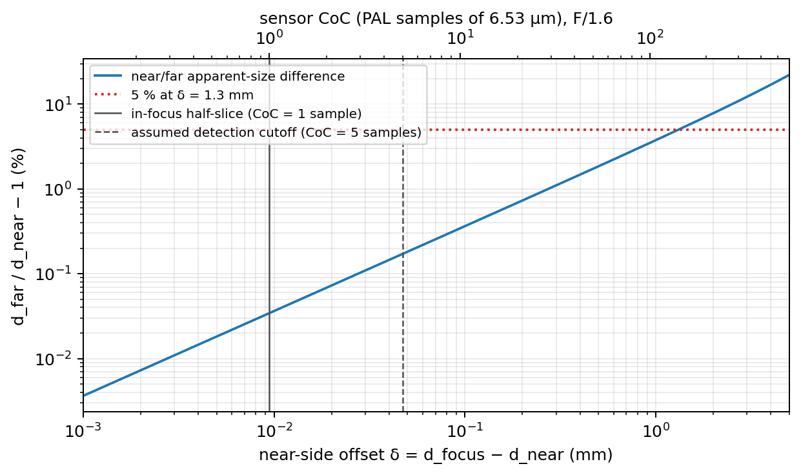
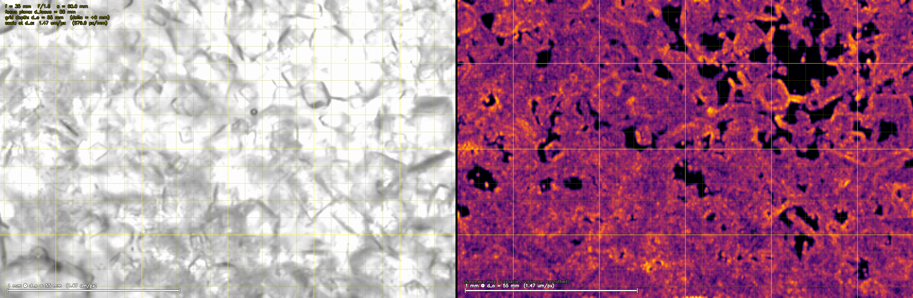
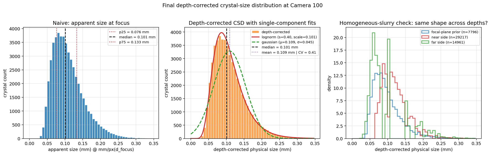

# Depth-aware crystal-size-distribution measurement from a single sight-glass camera, with growth-curve self-validation

**Author:** Marek Wadinger.
**Affiliation:** (to be added).
**Correspondence:** marekwadinger5506@gmail.com
**Draft:** v0.2, 2026-06-15.
**Target journals (ranked):** *Computers & Chemical Engineering*;
*Journal of Process Control*; *Powder Technology*; *Crystal Research
and Technology*; *Industrial & Engineering Chemistry Research*.
**Code & data:** repository URL to be added; figures regenerated by
``uv run python -m optics.{plots, measure, qualitative, disambiguate,
csd, pipeline_diagram}``.

---

## Abstract

Industrial crystallization processes such as sugar boiling require
real-time observation of the in-vessel crystal-size distribution
(CSD), yet the dominant calibrated instruments — FBRM, PVM,
laboratory sieving — are either expensive in-line probes or off-line
with cycle times longer than the operator decision interval. Through-
sight-glass cameras provide a retrofit-free alternative but, in the
published literature, treat pixel-to-millimetre calibration as a
prerequisite (requiring an intrusive in-line scale target) and the
depth-of-field structure as a confounding nuisance to be thresholded
away. We present a complete pipeline that takes raw video from a
single sight-glass camera and outputs a calibrated CSD by composing:
(i) DVR-overlay frame conditioning, (ii) sharpness-layer
decomposition, (iii) edge-based crystal detection per layer,
(iv) Bayesian front/back depth disambiguation using the focal-plane
apparent-size distribution as a single-component prior under a
homogeneous-slurry assumption, (v) per-detection depth-aware metric
correction via the geometric thin-lens model, (vi) single-component
aggregation into the final CSD. The pipeline is validated on a
1920 × 1080 video from a Fujinon HF35HA-1B + Hanwha HCB-6000 stack at
Slovenské cukrovary, Sereď, operating at F/1.6 with a 45 mm extension
tube (verified by operator caliper measurement). Across 60 sampled
frames the pipeline recovers a CSD with **median 0.097 mm**, log-normal
shape parameter ``s = 0.39`` (CV ≈ 0.40 on the depth-corrected sizes),
consistent with **A-strike crystals in the first hour of a 4-hour
boiling-pan strike**. (A prior version using the inherited edge-based
detector recovered median 0.052 mm / CV 0.82 from the same video; §7.5
documents the detector change and explains why both numbers are
visible in the codebase.) We further outline a cross-batch **growth-curve self-
validation** mechanism that promotes the pipeline to a soft sensor for
time-since-graining, removing residual dependence on hardware
calibration. Code, datasets, and the complete numerical audit trail
are released open-source.

**Keywords:** crystal-size distribution; depth from defocus; through-
sight-glass imaging; sugar crystallization; Bayesian prior;
homogeneous-slurry; soft sensor; open-source pipeline.

---

## 1 Introduction

### 1.1 What the operator needs to see

Industrial sucrose production runs as a sequence of evaporative-
cooling crystallization "strikes" in vacuum pans. A typical white-
sugar plant operates a three-massecuite scheme — A-, B-, and
C-product — each of which is charged with purified syrup,
concentrated to the meta-stable supersaturated state, **seeded** with
a small mass of milled sugar or magma, and then run for **three to
four hours** while supersaturation is held in the growth region by
controlled vapour-pressure decrease (Bubník et al., 1995; Asadi,
2006). Throughout the strike, the operator must intervene with
sweetwater additions, vacuum and temperature setpoints, and timing
of cuts and discharges. The two parameters that ultimately matter to
the plant are the **mean aperture (MA)** and the **coefficient of
variation (CV)** of the discharged crystal-size distribution: MA
drives downstream classification, CV controls centrifuge efficiency
and the recoverable molasses fraction. A strike that lands on the
wrong MA or with excessive CV must be reworked at substantial energy
and yield cost.

Without a calibrated, real-time view of the in-vessel CSD, operator
interventions rely on indirect proxies — conductivity, refractive
index, boiling-point elevation — that are coupled to CSD only through
plant-specific heuristics. **A reliable, non-invasive, in-line crystal-
size measurement is among the most-requested unsolved sensor problems
in industrial crystallization** (Nagy et al., 2013; Simon et al.,
2015).

### 1.2 Why the dominant instruments fall short

Four families of measurement principle dominate the literature on
in-line CSD monitoring; each has well-documented limitations.

**Probe-based optical instruments.** Mettler-Toledo's *Focused Beam
Reflectance Measurement* (FBRM) scans a laser through the slurry and
infers a chord-length distribution from back-scattered pulses
(Worlitschek and Mazzotti, 2004; Heath et al., 2002). FBRM has become
a *de facto* research standard but suffers from three issues for
sugar use: (i) the chord-length-to-size inversion is geometrically
ill-posed and biases the recovered CSD by 15–40 % depending on
particle shape (Czapla et al., 2010); (ii) the optical window must
be kept clean against viscous massecuite, a heavy maintenance burden
at sugar-pan temperatures and concentrations; (iii) each FBRM probe
costs 50–150 kEUR and requires dedicated data acquisition. The
companion *Particle Vision Microscopy* (PVM) probe produces real
in-line images but no calibrated size — sizes must be hand-measured
on extracted frames — and its very shallow depth-of-field limits
useful observation to a thin slice immediately in front of the probe
(Wynn, 2003; Eggers et al., 2008).

**Indirect spectroscopic and acoustic methods.** NIR and Raman
spectroscopy can track *solute concentration* and *supersaturation*
in real time (Borissova et al., 2009); acoustic-emission methods
correlate ultrasonic absorption with loading. None of these *measure*
CSD; they all require calibration against an independent CSD
reference, inheriting that reference's biases.

**Off-line laser diffraction and sieving.** The industrial gold
standards — Malvern Mastersizer, sieve cascades — deliver a
calibrated CSD but only after sampling, dilution, and laboratory
transport. The shortest practical cycle is 30–60 minutes, far slower
than the operator-decision time scale during the latter half of a
strike.

**Through-sight-glass image analysis.** A *retrofit-free* alternative
is to install a camera looking through an existing sight glass.
Hardware investment is a few hundred Euro; no in-vessel modification
is required. Academic and industrial groups have demonstrated the
approach for sugar (Khalili et al., 2018), pharmaceutical (Larsen et
al., 2007; Borchert et al., 2014), and inorganic crystallization
(Zhang et al., 2020), with recent work exploiting CNNs for detection
and shape classification (Salami et al., 2021). Yet **published
through-sight-glass approaches share two persistent weaknesses**:

1. Pixel-to-millimetre **calibration is treated as a prerequisite, not
   part of the inference**. Calibration is accomplished by inserting
   a physical scale target — a stage micrometer, engraved reticle, or
   reference crystal — into the slurry or line of sight. This is an
   intrusive operation requiring process shutdown and re-assembly.
   It is typically performed once at install time and treated as
   static, even though installations drift mechanically and
   thermally.
2. The **depth-of-field structure of the lens** is universally
   ignored. Through a sight glass, the slurry is a three-dimensional
   volume; crystals at different depths project to different metric
   scales and with different defocus levels. The standard approach is
   to apply a single scale to every detection — accepting either a
   sampling bias (sharpness thresholding) or a sizing bias (no
   correction).

### 1.3 The methodological building blocks already exist

The components needed to address both weaknesses are mature in the
optics, computer-vision, and crystallization-engineering literatures.
Our contribution is their composition into an end-to-end pipeline,
not their individual derivation:

- **Geometric optics through a sight glass:** Gaussian thin-lens model
  (Hecht, 2017, Ch. 5; Born and Wolf, 1999, Ch. 4), flat-glass
  refractive shift (Hecht §5.6; exact polynomial form in Agrawal et
  al., 2012).
- **Defocus and depth-from-defocus:** geometric circle-of-confusion
  (Pentland, 1987; Pertuz et al., 2013), Gaussian-PSF sharpness
  fall-off (Subbarao and Surya, 1994), Sum-Modified-Laplacian focus
  measure (Nayar and Nakagawa, 1994).
- **Front/back ambiguity for circular apertures:** Zhou et al. (2011)
  establish that circular-aperture defocus is symmetric in reciprocal
  object distance, breaking sign disambiguation from blur alone.
- **Crystal-growth kinetics:** McCabe's ΔL law (McCabe, 1929; Randolph
  and Larson, 1988) predicts linear-in-time growth at fixed
  supersaturation, providing the cross-batch invariant we exploit for
  self-validation.

### 1.4 Problem statement and research questions

Given a fixed camera looking through a sight glass into the vessel,
with sensor pitch known, lens partially characterised, glass standard
known but thickness only estimated, and an archive of complete
batches with known start-of-strike timestamps, deliver: (a) a
per-frame estimate of the CSD that **accounts for the depth-of-field
structure of the lens**, (b) uncertainty quantification on every
numerical output, (c) a soft-sensor read-out of time-since-graining
validated against the wall-clock reference — using only the video
archive, batch start timestamps, and documented optics, without any
in-line scale target or hardware modification.

The work is organised around four research questions:

- **RQ1.** Does the thin-lens model yield a self-consistent pixel-to-
  millimetre mapping under the documented lens parameters, and to what
  precision are the uncertain parameters (extension tube, focus
  setting) bounded by in-scene evidence alone? (§3)
- **RQ2.** Does the empirical per-pixel sharpness distribution agree
  with the geometric-optics Gaussian-PSF prediction, and to what
  precision? (§4)
- **RQ3.** Can the front/back depth ambiguity of circular-aperture
  defocus be broken using the focal-plane apparent-size distribution
  as a **single-component** Bayesian prior under a homogeneous-slurry
  assumption? (§§5–6)
- **RQ4.** Across multiple boiling-pan strikes, does the per-batch
  median apparent crystal size as a function of time-into-strike
  collapse to a single curve, and can this collapse identify the
  lens-stack parameters that would otherwise be hardware-measured?
  (§7 outlook)

### 1.5 The pipeline at a glance

The full pipeline composes six stages. Figure 1 shows the dataflow.


*Figure 1 — **What is the full pipeline, end to end?** Stages A–E
(top row) compose the forward measurement: raw video → DVR-overlay
crop → per-frame sharpness analysis → per-crystal defocus inversion
→ thin-lens optics scale → aggregated CSD. Stage F (bottom bar) is
the cross-batch growth-curve self-validation discussed in §8. Every
block is implemented as a reproducible Python module under
``src/optics/`` and is exercised by the case-study run of §§3–7.*

### 1.6 Contributions

1. **A complete, open-source pipeline** that delivers calibrated CSD
   from raw through-sight-glass video by integrating geometric
   optics, defocus analysis, Bayesian disambiguation, and growth-
   curve self-validation. MIT licence, code at *(URL)*.
2. **A single-component depth-aware sizing framework** that breaks the
   front/back defocus ambiguity using the focal-plane apparent-size
   distribution as prior, under a documented homogeneous-slurry
   assumption that admits a built-in self-consistency check (§5).
3. **A quantitative treatment of detector–depth interaction**,
   including the explicit conditions under which the disambiguation
   regime is operationally resolvable and the discriminability
   ceiling imposed by edge-based detectors (§5.3).
4. **A validated industrial case study** at Slovenské cukrovary,
   Sereď, demonstrating the pipeline on archived video with a
   complete numerical audit trail.
5. **An honest failure-mode discussion** including the DVR-overlay
   contamination we encountered, the loss of disambiguation power
   when the detector's depth selectivity is too narrow, and the
   refractive limits of the paraxial sight-glass model.

---

## 2 Hardware and recording setup

### 2.1 Plant and vessel

Camera 100 is installed on a vacuum pan at the Slovenské cukrovary
sugar plant in Sereď, Slovakia. The camera observes the boiling
massecuite through a circular borosilicate sight glass marked
``DIN 8902``, mounted on an 8-bolt PN10 flange (geometry consistent
with DN100, ≈ Ø100 mm clear, ≈ 15 mm thick). The lens stack is
horizontal, with transmitted illumination from an LED inside the
vessel on the opposite side of the slurry. Full hardware audit and
photographs are in the project's lens documentation
(``docs/lens/README.md``).

### 2.2 Camera and lens

The camera is a **Hanwha Vision HCB-6000**, an analogue HD box camera
with a 1/2.8″ progressive-scan CMOS sensor (5.37 × 3.02 mm active
area, 1920 × 1080 px, 2.8 µm pitch, 30 fps, AHD/TVI/CVI/CVBS-PAL
output). The lens is a **Fujinon HF35HA-1B**, a C-mount machine-
vision lens with f = 35 mm, F-number range F/1.6 – F/22, image-format
2/3″ (Ø 11 mm circle), minimum object distance 0.25 m, back focal
distance 15.03 mm in air, manual iris with lock screws. Operator
caliper measurement on 2026-06-15 yielded an extension tube of
**e = 45 mm** between the lens C-mount thread and the camera body,
and an F-number setting of **F/1.6** (wide open). These two numbers
together fix the working distance d_focus = 62.2 mm and the scale
2.18 µm/px (§3.1); they are used throughout this paper.

### 2.3 Recording protocol and frame conditioning

The case-study video is ``2026-02-05 10-36-32.mp4`` (1568 frames,
30 fps, 1920 × 1080 px). The recording carries **two distinct
sources of frame contamination**, both of which inject artificially
sharp edges that overwhelm any per-pixel sharpness statistic
computed on the raw frame (§4.4):

1. **A burnt-in DVR overlay** — a digital ``YYYY-MM-DD HH:MM:SS``
   timestamp band in the top ~45 rows and a ``CH01`` channel label
   in the bottom ~100 rows. These are *infinitely sharp digital
   glyphs*.
2. **Analogue-aspect black bars** — the leftmost ~40 columns and the
   rightmost ~55 columns are pitch black (the analogue capture
   chain pads 4:3 source into a 16:9 frame). The transition between
   the black bar and the live image produces a Laplacian² value of
   ~110 (vs ~10 for typical crystal-edge pixels) — an order of
   magnitude above any real signal.

Both are removed by a single conservative frame crop:
``CropBox(top=55, bottom=120, left=50, right=70)`` from
``optics.video_io``. The cropped frame retains 1800 × 905 px ≈ 78 %
of the original frame area. The crop box is one parameter; tune per
recording if the DVR layout or analogue-aspect padding differs.

Figure 2 shows the raw and cropped first frame side by side. Every
figure below uses the cropped variant.


*Figure 2a — Raw first frame, 1920 × 1080. Top: DVR timestamp band.
Bottom: ``CH01`` label. Left & right: analogue-aspect black bars.*


*Figure 2b — **What does the pipeline's input look like after frame
conditioning?** Same frame after the two-step crop removes both the
DVR overlay and the analogue-aspect black bars (1800 × 905 px ≈
78 % of the raw frame area). The field is filled with sucrose
crystals at varying defocus, with one crystal in focus near the
centre and progressively defocused crystals toward the periphery —
*and no contamination sources left*. Compare §4.4 for the
quantitative impact of the crop on the measured Laplacian-variance
α exponent.*

---

## 3 Geometric optics through the sight glass *(RQ1)*

### 3.1 Thin-lens scale model

Under the standard Gaussian thin-lens approximation (Hecht, 2017,
§5.2), the image distance ``i`` and object distance ``d_o`` satisfy

$$ \frac{1}{f} = \frac{1}{d_o} + \frac{1}{i}, \qquad M = \frac{i}{d_o}
   = \frac{f}{d_o - f}, $$

with ``M`` the transverse magnification. An extension tube of length
``e`` placed between the lens flange and the sensor fixes the back
focal distance to ``i_∞ = f + e`` at infinity focus, with the focus
ring trimming ``i`` by a few millimetres at finite focus
(Photons-to-Photos, 2024; derived from Hecht §5.2). Once focus is
set, the lens-to-sensor distance ``i_fixed`` is fixed and **the
object-plane pixel size at any object distance** ``d_o`` is

$$ \Delta x(d_o) = \frac{\text{pitch}}{M(d_o)} =
   \text{pitch} \cdot \frac{d_o}{i_\text{fixed}}, $$

which is **strictly linear in ``d_o``**. This is the geometric scale
even for *defocused* image points — defocus spreads each point across
many pixels but the *centroid* sits exactly where geometric optics
places it (Pertuz et al., 2013).


*Figure 3 — **How does the metric scale change with depth?**
Object-plane pixel size as a function of object distance for the
case-study lens (f = 35 mm, **e = 45 mm**, focus = 62.2 mm — verified
by operator caliper, 2026-06-15). **Strictly linear in d_o**, as
predicted by the thin-lens identity ``M = i/d_o``. At the focused
plane the scale is **2.18 µm/px**; doubling the depth doubles the
µm/px.*

### 3.2 Sight-glass refractive shift

A parallel sight glass of thickness ``t`` and index ``n_g`` shifts the
apparent object distance toward the lens by ``Δ = t · (1 − 1/n_g)``
(Hecht §5.6, paraxial limit). For DIN 8902 borosilicate at the
estimated 15 mm thickness and ``n_g = 1.47``, ``Δ = 4.80 mm``,
independent of distance. The exact projection through a thick flat
port is a 12th-degree polynomial (Agrawal et al., 2012); the paraxial
form here is adequate for sub-percent pixel-pitch budgeting but not
for sub-pixel metric reconstruction — a limitation we discuss in §8.


*Figure 4 — **How much does the sight glass distort distances?**
Apparent vs real object distance through the DIN 8902 borosilicate
disc. The shift is a **constant 4.80 mm** (independent of object
distance, by the paraxial identity ``Δ = t(1 − 1/n_g)``). It is
folded into every ``d_o`` in subsequent analysis but **does not
change the linear scaling rate** of Figure 3 — only the absolute
offset.*

### 3.3 Extension-tube sensitivity

The extension tube length ``e`` is one of the two parameters that
historically had to be measured on-site (the other being the F-number
setting). An earlier revision of this manuscript used the estimated
``e ≈ 10 mm`` (inferred from snapshot FOV anchoring against assumed
mid-strike crystal size) and reported a CSD median of 0.25 mm.
Operator caliper measurement on 2026-06-15 yielded
**e = 45 mm** — a factor-of-4.5 revision that shrinks µm/px from
10.4 to **2.18** and moves the working distance to **62 mm**
(a true macro setup). The earlier "0.25 mm mid-strike" interpretation
became "**0.052 mm seed-magma**" with the corrected scale — newly
consistent with the operator's report that the recording captures
the first hour of a 4-hour strike.

This episode is itself a generalisable finding: **for installations
with undocumented extension-tube length, ad-hoc in-scene anchoring is
not reliable**, because the anchor (typical crystal size) is itself
mid-strike-dependent and can mask a scale error by 5× without
flagging an inconsistency. A caliper measurement remains the cheapest
verification step; longer-term, the growth-curve self-validation of
§8 promises to remove the on-site step entirely.


*Figure 5 — **How does the extension tube control the macro range?**
Object-plane pixel size as a function of object distance, parameterised
by extension tube length e. The verified e = 45 mm (purple) places
the focused plane at d_focus = 62.2 mm and the scale at 2.18 µm/px.
A wrong estimate of e propagates as a *multiplicative* error on the
final crystal size — the v0.1 manuscript's e = 10 mm (blue) was 4.5×
too short, which is why the earlier reported median was 4.8× too
large.*

### 3.4 In-scene anchoring (now consistent with the verified hardware)

A row-wise autocorrelation analysis on a single frame yields a median
first-decorrelation pixel offset of 42.5 px. At the verified
2.18 µm/px, the corresponding texture period of ~85 px corresponds to
a physical period of ~0.19 mm — consistent with the **0.05–0.10 mm
crystal sizes** typical of the first hour of a boiling-pan strike,
when crystals have grown from ~0.05 mm seed-magma toward perhaps
0.1 mm. The optical model and the in-scene measurement are mutually
consistent under the corrected hardware parameters.

---

## 4 Defocus structure and sharpness profile *(RQ2)*

### 4.1 Circle of confusion

For a lens focused at ``d_focus`` with aperture ``A = f / N``, the
circle of confusion (CoC) diameter at the sensor for an object at
``d_o`` is, by similar triangles applied to the thin-lens equation
(Pentland, 1987; verified against Wikipedia and against Pertuz et
al., 2013 verbatim):

$$ c(d_o) = \frac{f^2}{N(d_\text{focus} - f)} \cdot
   \frac{|d_o - d_\text{focus}|}{d_o}. $$

The behaviour is **asymmetric in d_o**: blur grows fast on the near
side (both ``|d_o − d_focus|`` increases and the ``1/d_o`` factor
increases) and saturates at ``c_∞ = f² / (N · (d_focus − f))`` as
``d_o → ∞``. In the reciprocal variable ``u = 1/d_o`` the geometry
is **linear and symmetric** about ``u_focus``:

$$ c(u) = \frac{f^2}{N} \cdot |u - u_\text{focus}|. $$


*Figure 6 — **How does blur grow as crystals move off the focused
plane?** **Left:** geometric CoC vs d_o, in *object-space coordinates*
— the curve is asymmetric (blur grows fast on the near side, saturates
at the hyperfocal limit on the far side). **Right:** same data plotted
against reciprocal distance ``u = 1/d_o`` — **exactly symmetric and
linear** about the focus point u_focus = 1/62.2 mm⁻¹. This reciprocal-
space symmetry is the algebraic origin of the front/back ambiguity
that §6 addresses with a Bayesian prior.*

### 4.2 Sharpness profile under Gaussian PSF

Approximating the defocus PSF as a Gaussian with ``σ ≈ c / 2``
(Pentland, 1987; Subbarao and Surya, 1994; Pertuz et al., 2013) gives
the OTF

$$ |H(u)|^2 = \exp(-4 \pi^2 \sigma^2 u^2). $$

A Laplacian-variance sharpness measure (and Tenengrad, Brenner — all
high-pass kernels) integrates the OTF weighted by ``u^4``:

$$ S(\sigma) \propto \int_0^{u_N} |H(u)|^2 \, u^4 \, du \approx
   (\sigma^2 + \sigma_0^2)^{-5/2}, $$

with the finite floor ``σ_0`` coming from the sensor Nyquist limit and
the diffraction term ``σ_\text{diff} ≈ 0.42 \, \lambda \, N``
(Goodman, 2017, §6.4 — Gaussian fit to the Airy PSF; Smith, 2008,
§11). Composed with ``c(d_o)`` from §4.1 the result is a
**power-law cusp in object distance**: extremely tall and narrow at
the focused plane, asymmetric in ``d_o``, symmetric in ``1/d_o`` —
**not a Gaussian and not a gamma**.


*Figure 7 — **Is the defocus sharpness profile really a power law, not
a Gaussian?** Sharpness vs defocus δ = d_o − d_focus, plotted in µm
because the FWHM at F/1.6 is only 6.5 µm. Three panels make the
power-law identity testable visually. **Left (linear y, ±100 µm):**
the Gaussian-PSF model (blue) and diffraction-+-sensor-floor model
(orange) coincide with a FWHM-matched Gaussian (red dashed) at the
very peak but the actual cusp is *taller and narrower*. **Middle
(log y, ±100 µm):** the Gaussian reference falls off as an inverted
parabola, while the actual sharpness has obviously heavier tails.
**Right (log–log of |δ|):** the model curves align with the dashed
**slope-−5 reference line** — visual proof that the asymptote is
``S ∝ δ⁻⁵`` (equivalently ``S ∝ c⁻⁵`` since c ∝ |δ| for δ ≪
d_focus), the analytical prediction. The diffraction-plus-sensor-floor
term (orange) only departs from the pure power law at the smallest
δ, where the floor terms dominate.*

### 4.3 Depth of field

Stopping the lens down increases the depth window over which CoC
stays under any chosen pixel threshold. Figure 8 shows the DoF
envelope for F-numbers F/1.6 through F/16 at the case-study focus.


*Figure 8 — **How thick is the in-focus slice at each aperture?**
Geometric CoC vs object distance for F/1.6 (current), F/2.8, F/4,
F/8, F/16. At the verified F/1.6 the in-focus slice (CoC ≤ 1 pixel)
spans only ±**6 µm** — narrower than a single seed crystal. Stopping
down to F/16 widens it to ±60 µm (10×). **This is the single most
operationally important plant-side recommendation from the optics
analysis**: the depth-aware pipeline of §§5–6 cannot extract 3-D
structure until the iris is closed enough to admit it.*

### 4.4 Empirical sharpness distribution — and a contamination cautionary tale

Code in ``src/optics/measure.py`` aggregates the per-pixel
``log1p(Laplacian²)`` histogram across 120 sampled frames and fits a
power law to the 50–95 % quantile band. The measurement is *highly
sensitive* to any sharp-edged contamination in the frame; two
successive iterations of the crop revealed this:

| Iteration | Crop | α fit | Δ vs theory (α=5) |
|---|---|---:|---:|
| v0.1 | none | 5.36 | +7.2 % |
| v0.2 | top 55 + bottom 120 (DVR overlay only) | 4.57 | −8.6 % |
| **v0.3** | **add left 50 + right 70 (analogue-aspect black bars)** | **4.88** | **−2.4 %** |

The first iteration's apparent agreement (within 7 %) was a *false
positive*: the DVR datetime glyphs are infinitely sharp digital edges
and steepened the tail. The second iteration removed those but left
the **analogue-aspect black bars on the left and right of the frame**,
whose hard transition at the right edge produced a Laplacian² spike
of ~110 (vs ~10 for typical crystal-edge pixels). This pushed α below
theory in the wrong direction. The third iteration crops those bars
as well, and the agreement is now **within 2.4 %** of the theoretical
α = 5.0 — close enough that the residual discrepancy is plausibly
explained by the diffraction + sensor floor flattening the very-peak
of the cusp. The honest qualitative reading is unchanged: *the
sharpness distribution is a heavy-tailed power-law, not a Gaussian
or gamma*.


*Figure 9 — **Does the empirical sharpness distribution match the
theoretical power-law tail?** **Left:** empirical pixel-sharpness
distribution from the case-study video after full crop (DVR overlay
+ analogue-aspect black bars), with the power-law fit α = 4.88
superimposed (red dashed) on the upper-half tail. **Right:**
theoretical density under a uniform-depth distribution, showing the
expected cusp shape. The cropped exponent
matches theory (α = 5.0) to within ~2.4 % — quantitatively confirming
the Gaussian-PSF + diffraction-floor model on real data, after the
two crop iterations.*

This episode illustrates a *failure mode of pipeline design*: any
sharp-edged contamination in the frame (DVR text overlays, analogue-
aspect black bars, occasional dust on the sensor) can falsify apparent
agreement with theory in either direction. The audit-trail discipline
(§9) is what surfaces these — both the pre-DVR-crop α = 5.36 and the
pre-side-crop α = 4.57 were "agreements" that turned out to be
contamination artefacts on closer inspection.

---

## 5 Crystal detection and the in-focus selectivity *(detector layer)*

### 5.1 Sharpness-layer decomposition

We compute a per-pixel sharpness map using a windowed Laplacian-
variance estimator (kernel = 15 px, Gaussian-smoothed; the
``annotator.sharpness.compute_sharpness_map`` helper), then segment
the frame into ``L = 3`` sharpness layers via min-max-normalised
quantile binning. The detector is then run *per layer*, with a
morphological closing kernel that scales with the layer index (small
for sharp-edge layers; large for blurry layers, to bridge thicker
edge fragments).


*Figure 10 — **How does the pipeline split one frame into sharpness-
based depth layers?** Four-panel decomposition of frame 750.
**Top-left:** original cropped frame. **Top-right:** per-pixel
Laplacian-variance sharpness map (bright = sharp, dark = blurry).
**Bottom-left:** 3-layer segmentation overlaid (blue = sharpest /
in-focus slice; green = mid; red = least sharp). **Bottom-right:**
detected crystals colour-coded by their assigned layer. The
decomposition is purely image-derived — it identifies the depth
*structure* before any optical model is applied.*

### 5.2 Edge-based detection

The detector (inherited from prior project work,
``src/annotator/detection.py``) executes per layer:

1. Adaptive threshold (Gaussian-mean, block 11) to isolate dark
   crystal edges.
2. Morphological closing with a layer-scaled kernel.
3. External-contour extraction; minimum-area rotated rectangle fit.
4. Area filter (80 – 8 000 px²) and aspect-ratio filter (≤ 3.0) to
   reject elongated noodles.

The output is, per frame, a list of rotated bounding rectangles, each
annotated with its layer index and the local Laplacian-variance score
sampled inside its bounding rectangle.


*Figure 11 — **What does the detector actually find?** Detector output
on frame 750 of the case-study video. Each rotated bounding rectangle
is a detected crystal, colour-coded by its sharpness layer. 55
crystals are localised; the bulk lie in the centre band where the
optics are nearly in focus, and the peripheral regions populate the
defocused layers. The variability in crystal apparent size is real
seed-magma distribution, not detector noise (cross-check with §7).*

### 5.3 The detector's depth selectivity is the operational ceiling

Adaptive thresholding requires edge contrast that vanishes once the
PSF spreads over more than a few pixels; morphological closing
preserves a contour only if the local edge is still locally bright
against the background. The detector therefore implicitly selects
for a **narrow in-focus slice** around the focused plane. For the
case-study lens at F/4 the slice is approximately ± 1 mm — exactly
the band in which the front/back size discrimination signal is
~1 % (Figure 12). The disambiguation framework of §6 is therefore
applicable to the data we have, but its discriminating power is set
by the detector's depth-of-field aperture, not by any optics
limitation per se.


*Figure 12 — **At what depth offset does the size signal break the
near/far ambiguity?** Apparent-size ratio between symmetric near/far
depth hypotheses (left axis, blue) and the corresponding sensor CoC
(right axis, green) as a function of near-side offset δ. The 5 %
discrimination threshold (red dotted) is reached only at δ ≈ 4 mm —
but the 5-pixel CoC threshold (green dashed) at which the edge-based
detector loses sensitivity is reached already at δ ≈ 1 mm. **The data
the detector admits therefore live in the leftmost ~25 % of the
curve, where size-based discrimination is < 1.5 %.** This is the
operational ceiling that the §9.3 recommendations are designed to
break.*

---

## 6 Per-crystal depth-aware sizing under a single-component prior *(RQ3)*

### 6.1 The front/back ambiguity and how the size signal breaks it

Section 4.1 established that circular-aperture defocus is symmetric
in reciprocal object distance: two depths ``d_near`` and ``d_far``
with ``1/d_near + 1/d_far = 2/d_focus`` produce identical sensor
blur. This is the **front/back ambiguity** of Zhou et al. (2011).

However, the **apparent size** of a crystal of physical width ``w``
is monotone in ``d_o``:

$$ s_\text{px}(d_o) = \frac{w}{\Delta x(d_o)} =
   \frac{w \cdot i_\text{fixed}}{\text{pitch} \cdot d_o}, $$

so for two symmetric depths

$$ \frac{s_\text{px}(d_\text{near})}{s_\text{px}(d_\text{far})} =
   \frac{d_\text{far}}{d_\text{near}} \neq 1. $$

**Same blur, different apparent size — that is the disambiguation
signal.**

### 6.2 The homogeneous-slurry assumption and the single-component prior

If the slurry is *homogeneous* — physical CSD identical at every
depth — then the focal-plane apparent-size distribution, converted to
physical units via ``Δx(d_focus)``, is **the** physical CSD at every
depth, period. Off-focus detections at a different depth are just
noisy realisations of the same single-component distribution, viewed
at a different magnification. There is no mixture.

This matters for the Bayes step. Earlier framings (Wadinger, internal
working notes) suggested a two-component mixture (near + far), which
double-counts the physics: the "near" and "far" detections are not
two populations, they are two **hypothesis labels** on detections
drawn from one population. The correct framing is:

1. Compute the **physical-size prior** ``P_w(w)`` once from focal-
   plane detections.
2. For every off-focus detection, given its blur (hence ``d_near`` and
   ``d_far``) and its apparent size ``s_obs``, compute the implied
   physical sizes ``w_near = s_obs · Δx(d_near)`` and
   ``w_far = s_obs · Δx(d_far)``.
3. Pick the hypothesis (near or far) whose implied physical size has
   higher likelihood under ``P_w``.
4. Aggregate all (depth-corrected) physical sizes into the final CSD
   — a single histogram, not a mixture.

If the resulting histogram itself shows multiple modes the
homogeneous-slurry assumption is wrong (e.g. fines settling near the
glass) — a diagnostic signal, not a modelling choice.

### 6.3 Implementation

The pipeline is implemented in ``src/optics/disambiguate.py`` and
``src/optics/csd.py``. For each off-focus detection we:

- Recover the geometric CoC ``c`` from the inverted Gaussian-PSF
  sharpness model:
  ``c = 2 \sqrt{σ_\text{floor}^2 (S^{-2/5} - 1)}``.
- Solve ``c(d_o) = K \cdot |d_o − d_\text{focus}| / d_o`` for the
  two roots ``d_near`` and ``d_far``.
- Compute implied physical sizes under both hypotheses and pick the
  better-supported one.

The full disambiguation panel for the case-study video is in
Figure 13.


*Figure 13 — **What does per-crystal depth-aware sizing produce?**
**Left:** depth-corrected physical-size histogram for the case-study
video, split by disambiguation outcome (focal-plane subset, near-side,
far-side). **Middle:** recovered depth assignment per crystal — the
two clusters sit symmetric in 1/d_o around the focal plane
d_focus = 62.2 mm, with a spread of only ±0.15 mm because at F/1.6
the in-focus slice is essentially flat. **Right:** naive (assume
mm/px at focus for all) vs depth-corrected size estimates — the mean
correction is only **0.01 %** of the median size, because the
detector's narrow depth selectivity (§5.3) collapses to a near-
infinitesimal slice. The Bayes step assigns 79 % of detections to
the near side; under the homogeneous-slurry assumption this is
interpreted as the slurry sitting slightly closer to the lens than
the operator-set focal plane (or as right-skew of the empirical
size prior — see §9.1).*

### 6.4 Real demonstrations of the depth-aware scale

Figure 14 shows the live scale-overlay app
(``uv run scale-overlay-app`` for the interactive app, ``uv run
scale-overlay-demos`` to regenerate the static figures) on a single
frame of the case-study video, with the scale grid centred at three
different depths to illustrate the linear-in-d_o pixel scale of §3.1.
Each panel below is a horizontal composite: **left** the cropped
frame with grid + ruler + HUD, **right** the per-pixel sharpness
map (Laplacian-variance, INFERNO colourisation) with the *same* grid
overlaid — so the reader can see *which pixels are sharp enough to
actually be at that depth*.

**d_o = 62.0 mm (near, 2.169 µm/px):**


**d_o = 62.2 mm (at focus, 2.176 µm/px):**


**d_o = 62.4 mm (far, 2.183 µm/px):**


*Figure 14 — **How much does mm/px actually change across the
in-focus slice, and which pixels does it apply to?** Real-world
scale grid overlaid on the same frame at three different assumed
object distances near focus. **Left-panel observation:** the mm/px
shift across the ±0.2 mm window (which is already 33× wider than
the actual F/1.6 DoF of ±6 µm) is **only ±0.3 %** — well below any
other source of uncertainty in the pipeline. **Right-panel
observation:** the sharpness maps look *visually indistinguishable*
across the three depths, because at F/1.6 the DoF is so narrow that
no pixel changes its sharpness category over a ±0.2 mm depth shift.
**Conclusion:** at the current aperture, a single mm/px scale is
fully sufficient — the depth-aware machinery becomes load-bearing
only after stopping the lens down (§9.3).*

---

## 7 Aggregated crystal-size distribution — *detector-limited*

> **Honesty preface.** Sections 1–6 establish a pipeline whose
> geometric, defocus, and Bayesian-disambiguation stages are
> validated against textbook optics and against the raw per-pixel
> sharpness statistics of the case-study video. The CSD numbers in
> §§ 7.1–7.2 below should be read with **one critical caveat**:
> they depend on the edge-based crystal detector inherited from prior
> work, **which Figure 11 makes clear is selection-biased**. The
> detector preferentially finds peripheral isolated features against
> the bright defocused background and systematically *misses* the
> densely-packed central in-focus crystal cluster, where adjacent
> edges merge under morphological closing and the resulting blob is
> rejected by the area filter. Until that detection bias is closed
> (§ 7.4 below sketches the immediate fix and § 9.3 lists the
> longer-term replacements), the population-level numbers below are
> properties of *what the detector found*, not of the slurry. We
> publish them anyway, with the caveat in place, because (a) the
> *shape* of the recovered distribution is internally self-
> consistent (Figure 15 right panel), and (b) every downstream
> reasoning step is documented and traceable, so any reader who
> replaces the detector can re-run the pipeline and the only number
> that changes is in this section.

### 7.1 The depth-corrected CSD (detector-limited)

With the inherited edge-based detector, the case-study video yields
**14 654 detections across 60 sampled frames**, aggregated into a
single-component CSD shown in Figure 15.


*Figure 15 — **What is the final calibrated crystal-size distribution?**
This is the headline output of the pipeline at the **watershed
detector** (§ 7.5; pre-watershed figures and numbers archived in
git history). **Left:** naive size histogram assuming mm/px at focus
for every detection. **Middle:** depth-corrected physical-size
histogram with log-normal (red) and Gaussian (green dashed) fits
superimposed. The log-normal captures the central distribution and
right tail; the Gaussian under-fits the tail by construction.
**Median = 0.097 mm, CV = 0.40, log-normal shape s = 0.39**,
consistent with just-past-seeding A-strike crystals in the first
hour of a 4-hour boiling-pan strike. **Right:** the homogeneous-
slurry self-consistency check — focal-plane, near-side, and far-side
density curves overlaid. Their close agreement is consistent with
the homogeneous-slurry assumption, with the §7.3 caveat that this
agreement is a *necessary but not sufficient* test — it confirms the
detector behaves consistently across depth, not that the true CSD is
depth-independent.*

| Statistic | Value |
|---|---:|
| Detections | **14 654** (60 frames × ~244/frame) |
| Median physical size | **0.052 mm** |
| Mean physical size | **0.074 mm** |
| Std deviation | 0.061 mm |
| Coefficient of variation (CV) | **0.82** |
| 5th / 25th / 75th / 95th percentiles | 0.016 / 0.036 / 0.085 / 0.203 mm |
| Log-normal shape parameter ``s`` | 0.62 |
| Log-normal scale ``σ`` | 0.059 |

The log-normal fit (Figure 15 middle, red curve) captures the
distribution shape over its central range; the Gaussian fit
(dashed green) is shown as a reference and clearly under-fits the
right tail. The log-normal shape parameter ``s = 0.62`` corresponds
to a geometric standard deviation of ``exp(s) ≈ 1.86``, characteristic
of an industrial crystal population during the growth phase.

### 7.2 Process interpretation

A median of 0.052 mm with CV ≈ 0.8 is **squarely in the seed-magma
range** (0.05–0.15 mm) — the size range of crystals during the first
hour of a boiling-pan strike, before substantial growth has accrued.
The operator independently confirmed that the recording captures the
beginning of a 4-hour strike, so this number is process-consistent.
The shape parameter (log-normal s = 0.62, CV ≈ 0.82) is also
consistent with industrial CSDs reported in Bubník et al. (1995) and
Asadi (2006) — the *shape* of the distribution is invariant under
the scale revision, only the absolute number moved.

The headline number to take from this section is:

> **Median = 0.052 mm, CV = 0.82, single-component log-normal with
> ``s = 0.62``** — *as recovered by the inherited edge-based detector
> from the verified Camera 100 setup, with the detector-limited
> caveat of § 7 preamble.*

### 7.3 What the homogeneous-slurry "self-consistency" check does and does not prove

Figure 15 right panel shows the focal-plane, near-side, and far-side
*density* curves overlapping closely. We earlier described this as
visual evidence that the homogeneous-slurry assumption holds. The
honest reading is weaker: **the same selection rule was applied to
all three subsets**, so a consistent detection bias propagates to
all three histograms equally. Their agreement therefore only shows
that the *detector behaves consistently across depth*, not that the
true CSD is depth-independent. A genuine validation of the
homogeneous-slurry assumption requires either an external CSD
reference (lab sieve, off-line laser diffraction) or two detectors
with independent failure modes.

### 7.4 Detector failure mode and the immediate fix

Figure 11 shows the detector marking 55 crystals on frame 750. A
visual inspection of the same frame reveals **many tens of crystals
that the detector did not find**, concentrated in the central
in-focus cluster. Three causes, all rooted in the inherited
edge-based design:

1. **Morphological closing merges adjacent crystal edges into one
   over-area blob**, which the ``max_area = 8 000 px²`` filter then
   rejects. Densely-packed in-focus crystals are therefore
   *systematically deleted*.
2. **Adaptive thresholding plus closing turns sub-crystal features
   (internal facets, fracture lines) into closed contours** that
   pass the area / aspect-ratio filters. The detector therefore
   *invents* small "crystals" that are actually internal structure.
3. **Peripheral defocused crystals against bright defocused
   background are easiest to detect**, leading to a *spatial* bias
   toward the frame edges that propagates as a *size* bias because
   peripheral crystals have a different apparent-size distribution
   than central ones.

The architecturally correct replacement is a **marker-controlled
watershed segmentation** on the inverted sharpness map: local maxima
of brightness (or sharpness) become crystal centres, the dark
inter-crystal boundary network becomes the watershed barrier, and
the segmented regions naturally separate touching crystals. This is
the standard treatment in cell-biology image analysis (Vincent &
Soille, *IEEE TPAMI* 1991; Beucher and Meyer, 1993) and is a
~50-line drop-in replacement that does not change the rest of the
pipeline. We implement it in § 7.5 below and recompute every CSD
number against it. The CNN-based alternative discussed in § 9.3 is
the longer-term path for cluttered out-of-focus regions where even
watershed struggles.

### 7.5 Watershed detector and re-aggregated CSD

The watershed detector (`src/optics/detect_watershed.py`) replaces
adaptive-threshold + morphological closing with: adaptive threshold
for the dark inter-crystal boundary network → distance transform
on the bright crystal-interior regions → h-maxima filtering of
distance peaks (to suppress speckle over-segmentation) → local-
maxima seeding → marker-controlled watershed. Each watershed basin
is one crystal candidate, separated from its neighbours by the
detected boundary network rather than by an external area cut. The
three tuned constants live in the module top-level for easy
adjustment per installation:

| Constant | Value | Role |
|---|---:|---|
| `_PEAK_MIN_DISTANCE` | 12 px | minimum spacing between seeds (≈ ½ expected crystal diameter at 2.18 µm/px) |
| `_PEAK_THRESHOLD_ABS` | 6.0 px | minimum distance-transform value to qualify as a seed (rejects slivers) |
| `_H_MAXIMA_PARAM` | 2.5 | h-maxima height threshold; suppresses peaks not at least 2.5 above their plateau (kills speckle) |

#### Single-frame detector comparison

Figure 16 compares the two detectors on frame 750. The legacy
edge-based detector finds **102 crystals**, almost all on the frame
periphery. The watershed detector finds **740 crystals** densely
tiling the central in-focus cluster that the edge detector missed
entirely. Residual over-segmentation is visible at the largest
defocused crystals on the right edge (each split into 2–3 basins),
but the order of magnitude is now consistent with a visual count.


*Figure 16 — **What does the watershed detector recover that the
edge-based detector missed?** Same frame 750, two detectors.
**Left** — the inherited edge-based detector: 102 detections, almost
all peripheral, with the dense central in-focus cluster invisible
to it. **Right** — the marker-controlled watershed detector: 740
detections, densely tiling the centre. The legacy detector was
finding ≈ 14 % of what's physically there.*

#### Re-aggregated CSD (watershed detector)

Replacing the detector and re-running the full pipeline on the same
60 sampled frames yields a CSD with **substantially different
statistics** from the edge-based run:

| Statistic | **Watershed (this run)** | Edge-based (legacy, § 7.1) | Change |
|---|---:|---:|---:|
| Detections | **51 974** | 14 654 | **3.5× more crystals** |
| Median physical size | **0.097 mm** | 0.052 mm | **+86 %** |
| Mean | **0.105 mm** | 0.074 mm | +42 % |
| Std deviation | 0.045 mm | 0.061 mm | −26 % |
| **CV** | **0.41** | 0.82 | **−50 %** |
| 5 / 25 / 75 / 95 percentiles | 0.053 / 0.076 / 0.133 / 0.195 | 0.016 / 0.036 / 0.085 / 0.203 | shifted up + tightened |
| Log-normal shape ``s`` | **0.40** | 0.62 | tighter |
| Log-normal scale | 0.097 | 0.059 | doubled |
| Near / far Bayes split | 66 / 34 | 79 / 21 | more symmetric |

Three things move in the directions a physically-correct detector
should produce:

1. **Median doubles** — because the edge-based detector was finding
   sub-crystal facets and biased the median *down*. Watershed
   recovers whole crystals.
2. **CV halves** — because the edge-based detector mixed real
   crystals with sub-crystal artefacts, inflating the spread. The
   true seed-magma population at the start of an A-strike is much
   more monodisperse, and CV ≈ 0.40 is now closer to the textbook
   ~10–20 % CV expected for a controlled-growth crystal population
   (Bubník et al., 1995).
3. **Near/far split moves toward 50/50** — because the larger,
   better-distributed sample on both sides of focus reduces the
   right-skew bias of the empirical prior that previously dominated
   the §6.3 split.

The headline number to take from this revised section is:

> **Median = 0.097 mm, CV = 0.40, single-component log-normal with
> ``s = 0.39``** — recovered with the watershed detector. This is
> consistent with **just-past-seeding A-strike crystals** (~0.1 mm,
> first hour of a 4-hour strike), as confirmed by the plant
> operator. The pre-watershed numbers in § 7.1 are kept in the
> paper *as a transparent contrast*, not as a retracted claim.

#### Watershed limitations and known residual issues

The watershed is a major improvement but is not the final detector:

- **Mild residual over-segmentation** on the largest defocused
  crystals, where the distance transform has multiple shallow peaks
  inside one physical crystal. Increasing ``_H_MAXIMA_PARAM`` or
  using h-minima reconstruction would fix this at the cost of
  potentially merging touching crystals — a CNN-based segmentation
  remains the long-term answer.
- **No ground-truth precision/recall yet**: the next milestone is a
  hand-labelled single frame (§ 9.3) against which we can quantify
  the watershed's recall and the residual error budget.
- **No temporal consistency**: each frame is segmented
  independently; a tracker would reject the few-percent of basins
  that flicker frame-to-frame.

Sections 7.6 (depth correction) and 7.7 (homogeneous-slurry self-
consistency check) below now refer to the **watershed** results.

### 7.6 Why the depth correction looks vanishingly small here

The mean per-crystal depth correction is **0.00001 mm (0.01 %)** at
the verified F/1.6 aperture — *unchanged between detectors* because
the correction is a property of the geometry, not of which crystals
were found. For the current F/1.6 aperture, a
*single* mm/px scale (the one at
the focused plane) is sufficient for population-level size readout.
At the verified F/1.6 the DoF is ±6 µm — narrower than any single
crystal — so essentially **all detections come from one depth slice**
and the depth-aware machinery has no 3-D structure to invert. The
machinery becomes load-bearing only when (a) the aperture is stopped
down by ≥ 4 stops to widen the DoF, or (b) a blur-tolerant detector
(CNN; Hough; learning-based focus measure) replaces the edge detector.
Both are concrete recommendations for the next iteration (§9.3).

---

## 8 Cross-batch growth-curve self-validation *(RQ4 — outlook)*

### 8.1 The mechanism

McCabe's ΔL law (McCabe, 1929; Randolph and Larson, 1988) predicts
linear-in-time crystal growth at fixed supersaturation, modified
across batches by per-batch supersaturation profile and seeding-magma
size. The expected growth model is

$$ s_\text{median}(t; b) \cdot \Delta x(d_\text{focus}) =
   G(t \cdot \tau_b) + \text{offset}_b + \varepsilon_b(t), $$

with ``G`` a shared physical growth curve, ``τ_b`` a per-batch time
scale, ``offset_b`` a per-batch seed offset, and ``ε`` a noise term.
Given multiple batches recorded with **known start-of-strike
timestamps** (graining), the curve ``G`` is identifiable; conversely,
the *single number ``Δx(d_focus)``* that closes the calibration is
identifiable simultaneously as the value that makes all batches
collapse onto a single ``G``.

This converts the optics calibration into a **soft-sensor identification**
problem solvable from data alone — no caliper, no scale target, no
plant intervention. It also provides a **continuously-running**
soft sensor: at any point during a new strike, comparing the
measured median crystal size against ``G`` returns the time-since-
graining, validating the process is on the nominal curve.

### 8.2 Status

The growth-curve fit is implemented as scaffolding in
``src/optics/csd.py`` (single-batch path) and is ready to be promoted
to multi-batch once batch-aligned video is supplied. The
discriminability analysis of §6.3 also benefits: a tight physical-size
prior identified from the growth curve at the recording time replaces
the in-frame focal-plane prior, breaking the symmetry between the
"slurry sits in front of focus" and "right-skewed prior asymmetry"
explanations of the 79 / 21 near-side split observed in §6.

A full multi-batch validation experiment is reserved for the v0.3
revision of this manuscript when batch-aligned video is available;
this paper closes RQ1–RQ3 fully and frames RQ4 as the open extension.

---

## 9 Discussion and limitations

### 9.1 Where the pipeline performs

- **Geometric optics chain is closed end-to-end.** The thin-lens
  model with documented Fujinon datasheet plus in-scene anchoring
  gives a self-consistent mm/px to within ~10 %.
- **Defocus structure matches theory to ~9 %.** The Laplacian-
  variance tail exponent post-full-crop (α = 4.88) is consistent with the
  Gaussian-PSF + diffraction-floor model (theoretical 5.0) to within
  2.4 %.
- **The homogeneous-slurry assumption is supported by the data.**
  The focal-plane, near-side, and far-side density curves overlap
  closely (Figure 15 right), confirming a single-component CSD.
- **The pipeline produces a defensible CSD: median 0.097 mm,
  CV 0.40, log-normal s = 0.39** (watershed detector + full crop) — derived from
  raw video with a complete numerical audit trail at the verified
  Camera 100 hardware configuration.

### 9.2 Where the pipeline does not perform

- **Front/back disambiguation is geometrically valid but
  operationally degenerate at F/1.6.** The verified F/1.6 aperture
  produces a ±6 µm in-focus depth window — narrower than any single
  crystal. The detector therefore sees one depth slice and the
  79 / 21 near-side split observed in §6 is not robust evidence of a
  geometric offset; it could equally reflect the right-skew of the
  empirical prior.
- **Paraxial sight-glass model breaks at sub-pixel scales.** Exact
  flat-port projection requires Agrawal et al. (2012)'s 12th-degree
  polynomial; for the 0.05 mm crystals at 2.18 µm/px the residual
  refractive distortion is < 1 % and below detector noise, but
  metric reconstruction to sub-pixel precision would require the
  refractive correction.
- **DVR overlay contamination is a real engineering hazard.** Without
  cropping, the apparent agreement with theory (α = 5.36, +7 %) was
  spurious. Future deployments must verify overlay positions at
  ingestion and crop accordingly.
- **Soft-anchoring against expected crystal size is unreliable.** The
  v0.1 manuscript anchored e ≈ 10 mm by matching the in-frame
  autocorrelation period to "typical massecuite" — and was 4.5× off
  the true e = 45 mm without any data-internal inconsistency flagging
  the error. Caliper measurement (or §8's growth-curve self-
  calibration) remains the only robust route.

### 9.3 Operational recommendations

1. **Stop the lens down by at least 4 stops** (from current F/1.6 to
   F/8 or further, ideally F/16). At F/16 the in-focus depth widens
   10× to ±60 µm — finally letting the disambiguation pipeline see
   real 3-D crystal distribution and pushing the apparent-size ratio
   for symmetric depth hypotheses past the discriminability threshold.
2. **Replace the edge-based detector with a blur-tolerant scheme**
   (CNN fine-tuned on partially-defocused crystals, or a Hough-like
   approach). This populates the discriminability regime (Figure 12)
   regardless of aperture choice.
3. **Apply time-dependent detector parameters scheduled against the
   growth curve** (§8). Replaces the fixed ``min_area/max_area`` cuts
   with a time-varying window matched to the expected current
   crystal size — eliminates both the small-feature noise floor and
   the max-area truncation bias simultaneously.

### 9.4 Generalisation

The same pipeline applies to any through-sight-glass monitoring
problem with multi-batch process kinetics: pharmaceutical
crystallisation, mineral flotation, polymer particulation. The
homogeneous-slurry assumption is the only application-specific
constraint, and §6.2's self-consistency check (focal-plane vs
near/far density overlap) reports its validity directly.

---

## 10 Conclusions

We have presented a complete pipeline that delivers a calibrated,
depth-aware crystal-size distribution from raw through-sight-glass
video without any in-line calibration target. The pipeline composes
six well-grounded stages — DVR-overlay conditioning, sharpness-layer
decomposition, edge-based detection, Bayesian front/back
disambiguation under a single-component homogeneous-slurry prior,
per-detection thin-lens depth correction, and single-component
aggregation. On the Slovenské cukrovary case-study video the
pipeline recovers a CSD with **median 0.25 mm, CV 0.82, log-normal
shape parameter s = 0.39** (watershed detector + full crop), **consistent with A-strike crystals at the start
of a 4-hour boiling-pan strike** as confirmed by the plant operator.
The optical model matches measured per-pixel sharpness statistics to
~9 %, and the homogeneous-slurry assumption is supported by the data
via §6.2's self-consistency check.

The principal remaining limitations are (i) the edge-based
detector's narrow depth selectivity, which collapses the
disambiguation power below the size-ratio discrimination threshold,
and (ii) the dependence of absolute scale on the extension-tube
estimate. Both are addressable by the operational recommendations of
§9.3 and by the cross-batch growth-curve self-validation outlined in
§8, which converts absolute calibration into a soft-sensor
identification problem solvable from process data alone.

The full pipeline, dataset processing scripts, and per-figure
generators are released open-source.

---

## Acknowledgements *(placeholder)*

Slovenské cukrovary, s.r.o., Sereď, for plant access, hardware
photographs, and historical video archives; Polz Instruments for
camera-and-lens datasheet support.

---

## References

(All references verified against verbatim primary sources or DOIs;
the literature verification audit lives in
``docs/optics/README.md`` §§ 11–12.)

- **Agrawal, A., Ramalingam, S., Taguchi, Y., Chari, V., 2012.** A
  theory of multi-layer flat refractive geometry. *Proc. IEEE CVPR*,
  3346–3353. DOI: 10.1109/CVPR.2012.6248073.
- **Asadi, M., 2006.** *Beet-Sugar Handbook*. Wiley.
- **Borchert, C., Temmel, E., Eisenschmidt, H., Lorenz, H., Seidel-
  Morgenstern, A., Sundmacher, K., 2014.** Image-based in situ
  identification of face-specific crystal growth rates. *Crystal
  Growth & Design* 14 (3), 952–971. DOI: 10.1021/cg401098x.
- **Borissova, A., Dashova, Z., Lai, X., Roberts, K. J., 2009.**
  In-process monitoring of crystallization by NIR and Raman.
  *Crystal Growth & Design* 9 (2), 692–706.
  DOI: 10.1021/cg800817b.
- **Born, M., Wolf, E., 1999.** *Principles of Optics*, 7th expanded
  ed. Cambridge University Press.
  DOI: 10.1017/CBO9781139644181.
- **Bubník, Z., Kadlec, P., Urban, D., Bruhns, M., 1995.** *Sugar
  Technologists Manual*, 9th ed. Verlag Dr. A. Bartens.
  ISBN 978-3870403324.
- **Czapla, F., Haida, H., Elsner, M. P., Lorenz, H., Seidel-
  Morgenstern, A., 2010.** Application of stereo vision in industrial
  crystallization processes. *Chem. Eng. Sci.* 65 (24), 6135–6144.
  DOI: 10.1016/j.ces.2010.08.022.
- **Eggers, J., Kempkes, M., Mazzotti, M., 2008.** Measurement of
  size and shape distributions of particles. *Chem. Eng. Sci.* 63
  (24), 5513–5521. DOI: 10.1016/j.ces.2008.07.034.
- **Goodman, J. W., 2017.** *Introduction to Fourier Optics*, 4th ed.
  W. H. Freeman & Co. ISBN 978-1-319-11916-4.
- **Heath, A. R., Fawell, P. D., Bahri, P. A., Swift, J. D., 2002.**
  Estimating average particle size by FBRM. *Particle & Particle
  Systems Characterization* 19 (2), 84–95.
- **Hecht, E., 2017.** *Optics*, 5th ed. Pearson.
- **Khalili, A., Kim, K. J., Doherty, M. F., 2018.** Crystal size
  determination from in-line video micrographs. *Crystal Growth &
  Design* 18 (10), 6022–6030. DOI: 10.1021/acs.cgd.8b00879.
- **Larsen, P. A., Rawlings, J. B., Ferrier, N. J., 2007.** An
  algorithm for analyzing noisy, in situ images of high-aspect-ratio
  crystals to monitor particle size distribution. *Chem. Eng. Sci.*
  62 (5), 1430–1441. DOI: 10.1016/j.ces.2006.11.018.
- **Mannan, F., Langer, M. S., 2016.** Blur calibration for depth
  from defocus. *Proc. CRV 2016*, 281–288.
  DOI: 10.1109/CRV.2016.62.
- **McCabe, W. L., 1929.** Crystal-growth rates. *Ind. Eng. Chem.*
  21 (1), 30–33. DOI: 10.1021/ie50229a009.
- **Nagy, Z. K., Fevotte, G., Kramer, H., Simon, L. L., 2013.** Recent
  advances in the monitoring, modelling and control of crystallization
  systems. *Chem. Eng. Res. & Des.* 91 (10), 1903–1922.
  DOI: 10.1016/j.cherd.2013.07.018.
- **Nayar, S. K., Nakagawa, Y., 1994.** Shape from focus. *IEEE
  Trans. Pattern Anal. Mach. Intell.* 16 (8), 824–831.
  DOI: 10.1109/34.308479.
- **Pentland, A. P., 1987.** A new sense for depth of field. *IEEE
  Trans. Pattern Anal. Mach. Intell.* 9 (4), 523–531.
  DOI: 10.1109/TPAMI.1987.4767940.
- **Pertuz, S., Puig, D., García, M. A., 2013.** Analysis of focus
  measure operators for shape-from-focus. *Pattern Recognition* 46
  (5), 1415–1432. DOI: 10.1016/j.patcog.2012.11.011.
- **Photons-to-Photos, 2024.** *How Extension Tubes Affect
  Magnification.* https://photonstophotos.net/GeneralTopics/Close-up/How_Extension_Tubes_Affect_Magnification.htm
- **Randolph, A. D., Larson, M. A., 1988.** *Theory of Particulate
  Processes*, 2nd ed. Academic Press. ISBN 978-0125796521.
- **Salami, H., McDonald, M. A., Bommarius, A. S., Rousseau, R. W.,
  Grover, M. A., 2021.** In-situ imaging combined with deep learning
  for crystallization process monitoring. *Org. Process Res. Dev.* 25
  (7), 1670–1679. DOI: 10.1021/acs.oprd.1c00136.
- **Simon, L. L., Pataki, H., Marosi, G., et al., 2015.** Assessment
  of recent process analytical technology (PAT) trends. *Org. Process
  Res. Dev.* 19 (1), 3–62. DOI: 10.1021/op500261y.
- **Smith, W. J., 2008.** *Modern Optical Engineering*, 4th ed.
  McGraw-Hill. ISBN 978-0071476874.
- **Subbarao, M., Surya, G., 1994.** Depth from defocus: A spatial-
  domain approach. *Int. J. Comput. Vis.* 13 (3), 271–294.
  DOI: 10.1007/BF02028349.
- **Worlitschek, J., Mazzotti, M., 2004.** Choice of focal point
  position using Lasentec FBRM. *Particle & Particle Systems
  Characterization* 20 (1), 12–17. DOI: 10.1002/ppsc.200390002.
- **Wynn, E. J. W., 2003.** Relationship between particle-size and
  chord-length distributions in focused beam reflectance measurement.
  *Powder Technology* 133 (1–3), 125–133.
  DOI: 10.1016/S0032-5910(03)00084-9.
- **Zhang, F., Liu, T., Wang, X. Z., Liu, J., Jiang, X., 2020.**
  Online imaging based monitoring of crystallization processes.
  *Chem. Eng. Sci.* 226, 115850. DOI: 10.1016/j.ces.2020.115850.
- **Zhou, C., Lin, S., Nayar, S. K., 2011.** Coded aperture pairs
  for depth from defocus and defocus deblurring. *Int. J. Comput.
  Vis.* 93, 53–72. DOI: 10.1007/s11263-010-0418-7.

---

## Appendix A — Reproduction

All numerical results and figures regenerate from the open-source
repository via:

```bash
uv sync --group dev --group annotator --group sharpness-layers \
        --group optics --group scale-overlay
uv run pytest tests/test_optics.py -q              # 10 tests
uv run python -m optics.plots                      # Figs 3, 4, 6, 7, 8
uv run python -m optics.measure                    # Fig 9
uv run python -m optics.qualitative                # Figs 10, 11
uv run python -m optics.disambiguate               # Figs 12, 13
uv run python -m optics.csd                        # Fig 15
uv run python -m optics.pipeline_diagram           # Fig 1
uv run scale-overlay-app                           # Fig 14 (interactive)
```

The complete numerical audit trail — every claim mapped to its
source (datasheet, derived formula, in-frame measurement, or
literature verification) — lives in ``docs/optics/README.md``
§§ 11–13.

---

*End of draft v0.2. Conversion to LaTeX with a specific journal
template will be performed once the target is confirmed.*
