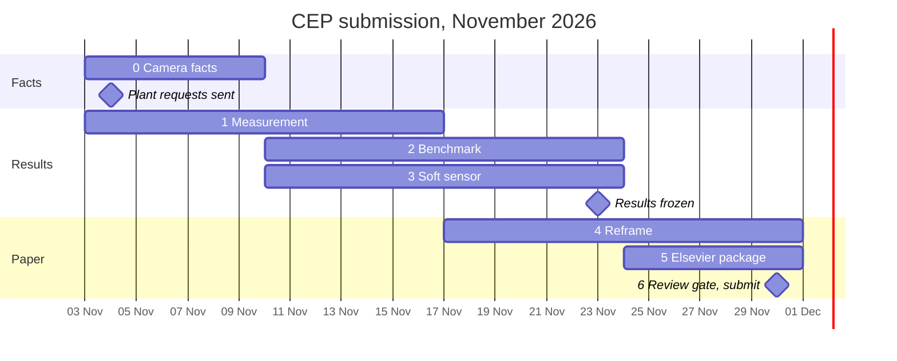

# Roadmap: CEP submission by 30 Nov 2026

**Why:** turn the sight-glass camera into a validated soft sensor of crystal growth for the seed pan, the first step
of OPTIVISION (vision → identification → control). **Venue:** *Control Engineering Practice*.
**Rules:** [`CLAUDE.md`](../../CLAUDE.md), [`AI_USE.md`](AI_USE.md).

| # | Phase | Week | Depends on | People | Agents | Done when |
| --- | --- | --- | --- | --- | --- | --- |
| 0 | **Settle camera facts:** camera label (manuscript says Hanwha, plant notes say "ADEMCO VIDEO"), PAL geometry (squeeze or crop), 5 mm adapter ring; update `configs/camera_100.toml`; site: model sticker, spacer caliper, ruler/graticule at inner glass face, DVR model | W1 | – | Marek with Fedor | sered-plant-expert, optics-data-expert | Pixel scale ± 1σ cited to a source (model: ±10 % at 95 %; in-image check waits on site) |
| 1 | **Measurement:** Cellpose on the 2026-10-30 lossless strikes, giving size distribution against time | W1–W2 | 0, annotations | Annotators (inter-annotator agreement) | tdd-guide, python-reviewer, optics-data-expert | Held-out AP reported; distribution inside the microscope ranges at matched times |
| 2 | **Benchmark:** microscope photos (54 of 54 read), Mastersizer as starting anchor, detector comparison | W2–W3 | data from 1 | Ask the plant for a discharge sieve or Mastersizer sample and SCADA for 2026-10-30 (send in W1) | citation-finder, opponent | Comparison table exists |
| 3 | **Soft sensor** (the control contribution): crystal-growth model plus the camera's mean size, into an EKF/UKF estimating growth rate or time-since-seeding; compare with a SCADA-only estimator | W2–W3 | 1 | One named teammate | python-reviewer | Beats the SCADA-only baseline, validated per strike |
| 4 | **Reframe for control readers:** research questions and contributions built around operator decisions; optics to an appendix; remove draft markers | W3–W4 | 1–3 | Marek approves every claim edit ([`CLAIM_CHANGES.md`](CLAIM_CHANGES.md)) | thesis-writer, bridging-reviewer, supervisor | Approved draft |
| 5 | **Elsevier package:** two-column LaTeX, highlights, declarations, cover letter, LICENSE | W4 | 4 | Each author: ORCID, CRediT roles, grant number, written plant approval | thesis-writer, notation-checker, lint-fixer, citation-finder, build-validator | Clean build; every DOI resolves |
| 6 | **Review gate** | W4 (Nov 30) | 5 | All co-authors approve the final PDF | peer-reviewer (as a CEP referee), opponent | No blocker from the two 2/5 reviews remains |

Weeks: W1 Nov 3–9, W2 Nov 10–16, W3 Nov 17–23, W4 Nov 24–30.

## Open

- Grounded on `docs/cep-grounded-draft` (2026-11-03): signal chain and per-axis scale (`optics.scale_chain`), every
  paper number rerun (`scripts/rerun_paper_numbers.py`), clip date and anchors, 54 microscope photos, bibliography
  (`SOURCES.md`); manuscript rewritten with §7 as a detector failure analysis.
- Waits on annotations: detector P/R/F1, Cellpose AP, inter-annotator agreement, camera vs microscope sizes, growth
  fit (`\pending` in `csd.tex`, `growth.tex`, `discussion.tex`).
- Waits on site: camera sticker, spacer caliper and mount photo, ruler/graticule at the inner glass face, DVR model,
  glass stamp; author decision on the clip date (02-04 vs 02-05).
- The Phase 3 teammate; each author confirms their CRediT roles in
  [`CREDIT.md`](CREDIT.md).

## CEP requirements

From the guide as read for the sibling CEP paper (`pv-contamination-tuning-ad/research/ROADMAP.md`, 2026-10-30):
elsarticle two-column `5p`, LaTeX only, 20-page limit; abstract ≤ 250 words; 1–6 keywords; 3–5 highlights of
≤ 85 characters as a separate file; research data Option C; Data availability, AI declaration and
Acknowledgements directly before the references.
