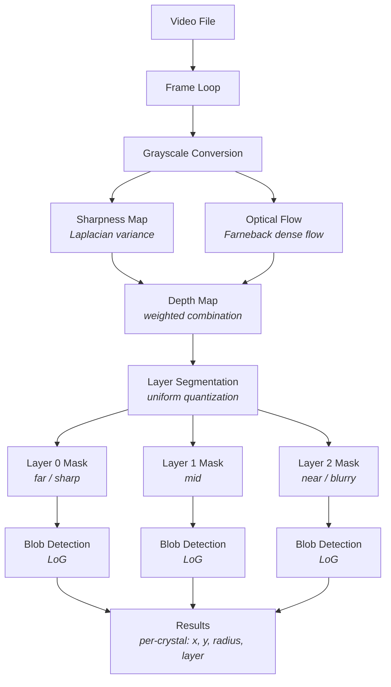
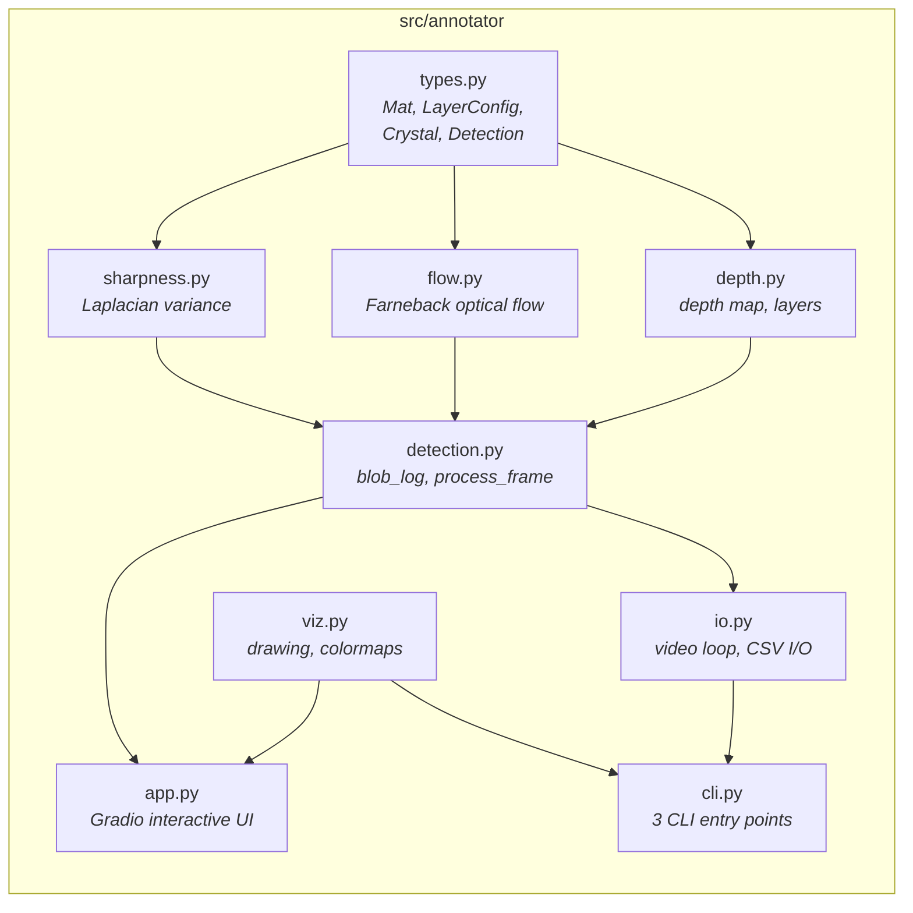

# Annotator

Crystal video layer decomposition and object detection. Decomposes microscopy videos of crystal formation into depth layers using focus and motion analysis, then detects and measures individual crystals per layer.

**Fully deterministic** — no ML models, just classical computer vision (OpenCV + scikit-image).

## How It Works

Crystals at different depths exhibit three correlated properties:

| Depth | Focus   | Speed  | Apparent Size |
| ----- | ------- | ------ | ------------- |
| Near  | Blurry  | Fast   | Large         |
| Mid   | Sharper | Slower | Medium        |
| Far   | Sharp   | Slow   | Small         |

The pipeline exploits all three signals to separate layers and detect crystals within each.

### Pipeline Dataflow



### Module Structure



## Installation

Requires Python 3.13+ and [uv](https://docs.astral.sh/uv/).

```bash
# Clone and install
git clone <repo-url> && cd crystalization
uv sync

# With interactive app support (installs Gradio)
uv sync --group dev
```

## Usage

### Interactive Parameter Tuner (recommended first step)

```bash
uv run annotator-app
```

Opens a browser UI where you can:

- Load a video and pick any frame
- Adjust all detection parameters with sliders
- See real-time updates of detections, sharpness map, optical flow, and layer segmentation

### Batch Analysis

```bash
# Basic: process video, output summary CSV
uv run annotator-analyze video.mov

# Full: with per-crystal details, every 3rd frame
uv run annotator-analyze video.mov \
    -o stats.csv \
    --detailed crystals.csv \
    --frame-skip 3

# Tune detection sensitivity
uv run annotator-analyze video.mov \
    --num-layers 4 \
    --blob-threshold 0.1 \
    --min-sigma 5 \
    --max-sigma 50
```

**Output: `stats.csv`** (one row per frame per layer)

| frame | layer | crystal_count | mean_radius |
| ----- | ----- | ------------- | ----------- |
| 0     | 0     | 17            | 4.24        |
| 0     | 1     | 108           | 4.40        |
| 0     | 2     | 1201          | 15.90       |

**Output: `crystals.csv`** (one row per crystal)

| frame | layer | crystal_id | x     | y     | radius | area  |
| ----- | ----- | ---------- | ----- | ----- | ------ | ----- |
| 0     | 0     | 0          | 123.4 | 456.7 | 5.66   | 100.5 |

### Visualization Video

```bash
# 4-panel video: detections + sharpness + flow + layers
uv run annotator-visualize video.mov -o viz.mp4

# Faster: downscale processing, skip frames
uv run annotator-visualize video.mov \
    --process-size 480 \
    --frame-skip 5
```

### Annotate Original Video

```bash
# First generate detailed CSV, then overlay on original
uv run annotator-analyze video.mov --detailed crystals.csv
uv run annotator-annotate video.mov crystals.csv -o annotated.mp4
```

## CLI Reference

### annotator-analyze

| Flag                 | Default             | Description                                     |
| -------------------- | ------------------- | ----------------------------------------------- |
| `video`              | _required_          | Input video path                                |
| `-o, --output`       | `crystal_stats.csv` | Summary CSV output                              |
| `--detailed`         | _none_              | Per-crystal CSV output                          |
| `-n, --num-layers`   | `3`                 | Number of depth layers                          |
| `--max-frames`       | `0` (all)           | Limit frames processed                          |
| `--frame-skip`       | `1`                 | Process every Nth frame                         |
| `--sharpness-weight` | `0.6`               | Sharpness contribution to depth map             |
| `--flow-weight`      | `0.4`               | Optical flow contribution to depth map          |
| `--min-sigma`        | `3.0`               | Smallest blob scale (pixels)                    |
| `--max-sigma`        | `30.0`              | Largest blob scale (pixels)                     |
| `--blob-threshold`   | `0.05`              | Detection sensitivity (lower = more detections) |

### annotator-visualize

All flags from `annotator-analyze` plus:

| Flag             | Default | Description                             |
| ---------------- | ------- | --------------------------------------- |
| `-w, --width`    | `1920`  | Output video width                      |
| `--process-size` | `960`   | Max processing dimension (0 = full res) |

### annotator-annotate

| Flag           | Default                 | Description                 |
| -------------- | ----------------------- | --------------------------- |
| `video`        | _required_              | Input video path            |
| `csv`          | _required_              | Detailed crystal CSV        |
| `-o, --output` | `crystal_annotated.mp4` | Output video path           |
| `--cross-size` | `8`                     | Cross marker half-size (px) |
| `--thickness`  | `2`                     | Marker line thickness       |
| `--max-frames` | `0` (all)               | Limit frames written        |

## Parameter Tuning Guide

| Parameter          | Effect           | Increase to...             | Decrease to...          |
| ------------------ | ---------------- | -------------------------- | ----------------------- |
| `num_layers`       | Depth resolution | Finer depth separation     | Broader grouping        |
| `sharpness_weight` | Focus vs motion  | Rely more on blur          | Rely more on speed      |
| `blob_threshold`   | Detection count  | Fewer, stronger detections | More, weaker detections |
| `min_sigma`        | Smallest crystal | Ignore tiny blobs          | Detect smaller crystals |
| `max_sigma`        | Largest crystal  | Detect bigger blobs        | Ignore large regions    |
| `blur_kernel`      | Smoothing        | Smoother sharpness map     | More local detail ions  |
| `blur_kernel`      | Smoothing        | Smoother sharpness map     | More local detail       |

## Development

```bash
# Lint
uv run ruff check src/annotator/
uv run ruff format src/annotator/

# Type check
uv run ty check src/annotator/
```

## Project Structure

```
crystalization/
├── pyproject.toml
├── README.md
├── datasets/
│   └── *.mov                    # input videos
└── src/
    └── annotator/
        ├── __init__.py          # public API
        ├── types.py             # dataclasses + type aliases
        ├── sharpness.py         # Laplacian focus measure
        ├── flow.py              # Farneback optical flow
        ├── depth.py             # depth map + layer segmentation
        ├── detection.py         # blob detection + frame pipeline
        ├── io.py                # video processing + CSV I/O
        ├── viz.py               # drawing + colormap utilities
        ├── cli.py               # CLI entry points
        └── app.py               # Gradio interactive tuner
```
