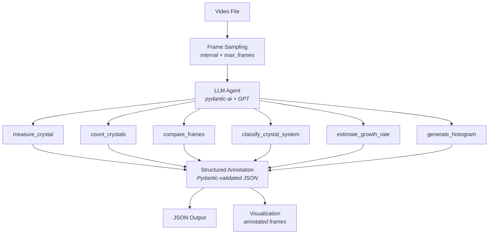
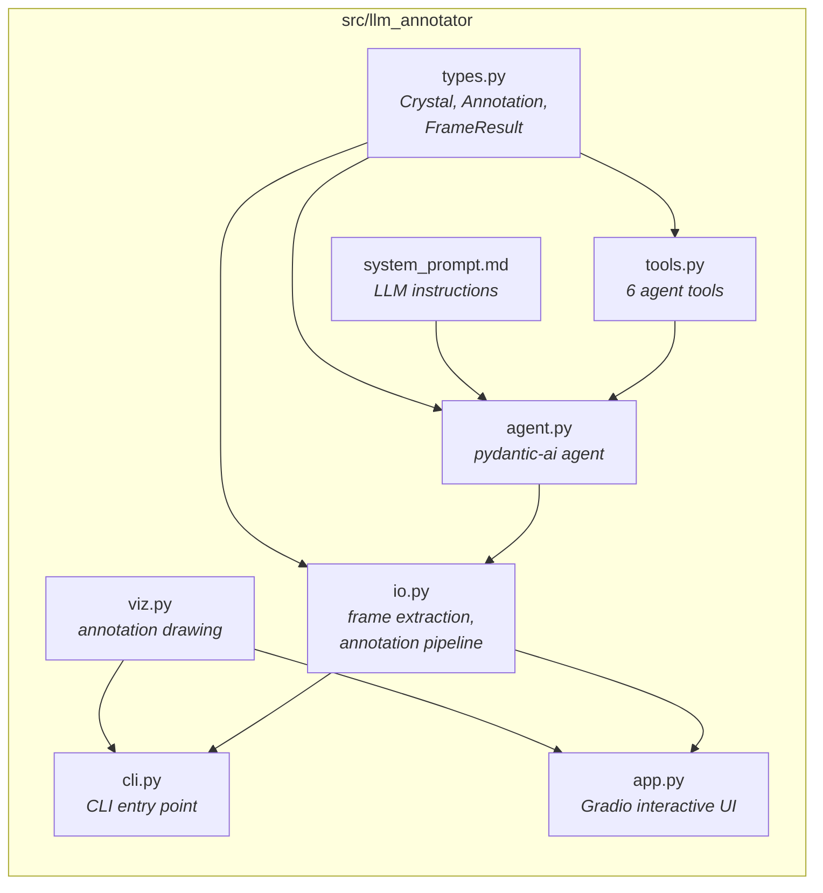

# LLM Annotator

LLM-powered crystal annotation for microscopy video. Uses a vision LLM (OpenAI GPT via pydantic-ai) to provide rich semantic annotation -- crystal system classification, growth stage assessment, and persistent tracking across frames.

**Non-deterministic** -- unlike the classical `annotator` (edge-based CV), this module delegates perception to a vision LLM and enforces structure through validated Pydantic output.

## How It Works

### Pipeline Dataflow



### Depth Layers

Crystals are classified into three depth layers based on visual properties:

| Depth | Focus   | Speed  | Apparent Size |
| ----- | ------- | ------ | ------------- |
| Near  | Blurry  | Fast   | Large         |
| Mid   | Sharper | Slower | Medium        |
| Far   | Sharp   | Slow   | Small         |

### Crystal Tracking

Each crystal receives a persistent ID that the agent maintains across frames. The agent uses spatial proximity, size continuity, and depth layer membership to re-identify crystals as they move, grow, or change focus between sampled frames.

### Module Structure



## Installation

Requires Python 3.13+ and [uv](https://docs.astral.sh/uv/).

```bash
uv sync --group llm-annotator
```

Set your OpenAI API key:

```bash
export OPENAI_API_KEY="sk-..."
```

## Usage

### Interactive UI (recommended first step)

```bash
uv run llm-annotator-app
```

Opens a browser UI where you can:

- Upload a video and configure sampling parameters
- Run the LLM annotation pipeline
- Browse annotated frames with crystal overlays
- Inspect the structured JSON output

### CLI Annotation

```bash
# Basic: annotate video, output JSON
uv run llm-annotator-annotate video.mov

# Custom sampling and output
uv run llm-annotator-annotate video.mov \
    -o annotations.json \
    --frame-interval 30 \
    --max-frames 10 \
    --process-size 480

# Use a specific model
uv run llm-annotator-annotate video.mov \
    --model gpt-4o
```

### Programmatic

```python
from llm_annotator import build_agent, annotate_video

# Build the pydantic-ai agent
agent = build_agent(model="gpt-4o")

# Run annotation pipeline
results = annotate_video(
    agent=agent,
    video_path="video.mov",
    frame_interval=30,
    max_frames=10,
    process_size=480,
)

# Inspect results
for frame_result in results:
    print(f"Frame {frame_result.frame_index}: "
          f"{len(frame_result.crystals)} crystals")
    for crystal in frame_result.crystals:
        print(f"  ID={crystal.id} layer={crystal.layer} "
              f"system={crystal.crystal_system}")
```

## Agent Tools

The LLM agent has access to six tools that ground its annotations in measurable data:

| Tool                     | Purpose                                               |
| ------------------------ | ----------------------------------------------------- |
| `measure_crystal`        | Pixel-level measurement at (x, y) region              |
| `count_crystals`         | Run classical CV annotator pipeline for a frame       |
| `compare_frames`         | Temporal comparison between two frames                |
| `classify_crystal_system`| Shape-based crystallographic classification           |
| `estimate_growth_rate`   | Growth rate from tracked crystal history               |
| `generate_histogram`     | Size distribution chart per depth layer               |

## Output Format

The pipeline produces structured JSON validated by Pydantic models:

```json
{
  "video_path": "video.mov",
  "model": "gpt-4o",
  "frames": [
    {
      "frame_index": 0,
      "timestamp_sec": 0.0,
      "crystals": [
        {
          "id": 1,
          "x": 234.5,
          "y": 178.2,
          "radius": 12.3,
          "layer": "mid",
          "crystal_system": "monoclinic",
          "growth_stage": "developing",
          "confidence": 0.87
        }
      ],
      "layer_summary": {
        "near": {"count": 3, "mean_radius": 28.1},
        "mid": {"count": 12, "mean_radius": 11.4},
        "far": {"count": 45, "mean_radius": 4.2}
      }
    }
  ]
}
```

## CLI Reference

### llm-annotator-annotate

| Flag                   | Default               | Description                                |
| ---------------------- | --------------------- | ------------------------------------------ |
| `video`                | _required_            | Input video path                           |
| `-o, --output`         | `annotations.json`    | JSON output path                           |
| `--frame-interval`     | `30`                  | Sample every Nth frame                     |
| `--max-frames`         | `0` (all)             | Limit number of frames processed           |
| `--process-size`       | `480`                 | Max processing dimension (0 = full res)    |
| `--model`              | `gpt-4o`              | OpenAI model name                          |
| `--temperature`        | `0.0`                 | LLM sampling temperature                   |
| `--viz`                | _none_                | Output directory for annotated frame images|

## Observability

The module uses [Logfire](https://logfire.pydantic.dev/) for tracing LLM calls and tool invocations.

### Local development

```bash
# Start Logfire in local mode (no cloud account needed)
export LOGFIRE_SEND_TO_LOGFIRE=false
uv run llm-annotator-annotate video.mov
```

### Cloud tracing

```bash
export LOGFIRE_TOKEN="your-token"
uv run llm-annotator-annotate video.mov
```

**What is traced:**

- Each LLM request/response (prompt tokens, completion tokens, latency)
- Tool calls (which tool, arguments, return value)
- Frame processing timing
- Pydantic validation errors

## Parameter Tuning Guide

| Parameter        | Effect               | Increase to...                  | Decrease to...                |
| ---------------- | -------------------- | ------------------------------- | ----------------------------- |
| `frame_interval` | Temporal coverage    | Faster processing, fewer frames | Denser temporal sampling      |
| `max_frames`     | Total frames         | Process more of the video       | Faster, cheaper runs          |
| `process_size`   | Spatial resolution   | More detail for LLM to see      | Faster, lower token cost     |
| `model`          | LLM capability       | Better accuracy (gpt-4o)        | Lower cost (gpt-4o-mini)     |
| `temperature`    | Output variability   | More diverse annotations        | More deterministic results    |

## Development

```bash
# Lint
uv run ruff check src/llm_annotator/
uv run ruff format src/llm_annotator/

# Type check
uv run ty check src/llm_annotator/
```

## Project Structure

```
src/llm_annotator/
    __init__.py          # public API
    types.py             # Pydantic models (Crystal, Annotation, FrameResult)
    system_prompt.md     # LLM system prompt with annotation instructions
    agent.py             # pydantic-ai agent setup (build_agent)
    tools.py             # 6 agent tools (measure, count, compare, classify, growth, histogram)
    io.py                # frame extraction + annotation pipeline (annotate_video)
    viz.py               # annotation drawing on frames
    cli.py               # CLI entry point (llm-annotator-annotate)
    app.py               # Gradio interactive UI (llm-annotator-app)
```
