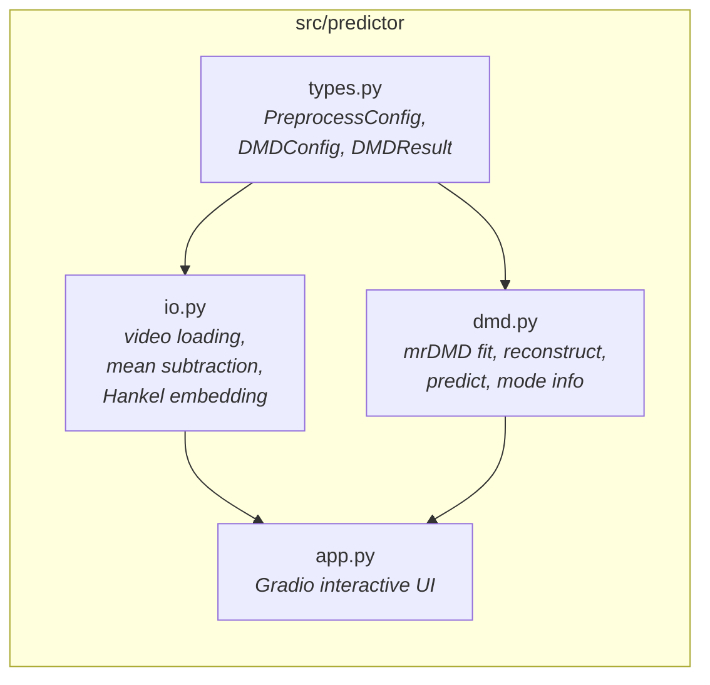

# Predictor

Video decomposition and prediction using multi-resolution Dynamic Mode Decomposition (mrDMD). Decomposes microscopy video into spatiotemporal modes that capture distinct dynamic patterns, enabling mode-selective reconstruction and future frame prediction.

Uses [PyDMD](https://github.com/PyDMD/PyDMD) for the core decomposition.

## Motivation

The annotator module detects crystals using spatial features (focus, motion, size) but treats each frame independently. The predictor takes a complementary approach: model the _temporal dynamics_ of the entire video as a linear dynamical system, then decompose it into coherent spatiotemporal modes.

The goal is twofold:

1. **Object filtering via mode selection** -- different DMD modes capture different dynamic patterns. Crystals at different depths move at different speeds and may separate into distinct modes, allowing filtering by selecting/deselecting modes.
2. **Prediction** -- extrapolate the identified dynamics to generate plausible future frames.

## Design Decisions

### Mean subtraction before fitting

Crystal microscopy video contains static background. Without mean subtraction, DMD wastes nearly all its capacity on a single mode representing the static image, leaving the remaining modes to fit noise. Subtracting the temporal mean forces every mode to capture actual dynamics. The mean is stored separately and added back for display.

### Multi-resolution DMD over standard DMD

Standard DMD assumes a single time scale. Crystal videos contain dynamics at multiple scales (slow drift, faster oscillations). mrDMD recursively splits the time window, fitting DMD at each level. This gives modes organized by temporal resolution -- level 0 captures the slowest dynamics, higher levels capture faster phenomena.

### Eigenvalue stabilization for prediction

DMD eigenvalues with |lambda| < 1 cause predictions to decay to zero; |lambda| > 1 causes blowup. Projecting eigenvalues onto the unit circle (|lambda| = 1) makes predictions oscillatory and stable. This is togglable in the UI since unstabilized predictions can reveal which modes are growing vs decaying.

### Aggressive downsampling

DMD operates on a snapshot matrix of shape (pixels x frames). At full resolution, this is prohibitively large. Defaults:

- **120p** (320x240 = ~77K pixels) -- sufficient for capturing crystal-scale dynamics
- **frame_skip=10** (~5.6 fps from 56 fps source) -- crystal motion is very subtle, high FPS adds noise without information
- **svd_rank=5** -- keeps only the dominant modes, regularizes against noise
- **max_level=2** -- deeper levels split too-small time windows (with ~48 frames, level 3 windows have ~6 frames each -- not enough for meaningful decomposition)

### Two-phase Gradio interaction

DMD fitting takes seconds, but exploring modes (reconstruction, prediction) is instant once fitted. The UI separates these: a "Fit" button runs the expensive computation and stores results in `gr.State()`, then mode checkboxes / sliders trigger cheap matrix multiplications.

## How It Works

### Pipeline

```
Video file
    |
    v
[io.py] Load + downsample to 120p grayscale
    |
    v
[io.py] Subtract temporal mean
    |    (mean stored for re-addition during display)
    v
[io.py] Optional Hankel time-delay embedding
    |
    v
[dmd.py] Fit mrDMD -> modes, dynamics, eigenvalues
    |
    v
[dmd.py] User selects mode subset
    |
    +--> Reconstruct: modes[:, sel] @ dynamics[sel, :] + mean
    |
    +--> Predict: extrapolate dynamics via eigenvalues + mean
```

### Mode anatomy

Each DMD mode has:

| Property            | Meaning                                                             |
| ------------------- | ------------------------------------------------------------------- |
| **Spatial pattern** | Which pixels this mode affects (visualized as grayscale image)      |
| **Frequency**       | How fast the mode oscillates (from eigenvalue angle)                |
| **Growth rate**     | Whether the mode is growing or decaying (from eigenvalue magnitude) |
| **Level**           | mrDMD resolution level (0 = slowest dynamics)                       |

### Module structure



## Installation

```bash
uv sync --group predictor
```

## Usage

### Interactive mode explorer (recommended)

```bash
uv run predictor-app
```

1. Upload a video
2. Adjust preprocessing (resolution, frame skip) and DMD parameters (rank, levels)
3. Click **Fit mrDMD**
4. Select/deselect modes via checkboxes to see what each captures
5. Scrub the **Training frame** slider to compare original vs reconstructed
6. Adjust **Prediction horizon** and watch the prediction video

### Programmatic

```python
from predictor import (
    PreprocessConfig, DMDConfig,
    load_video_snapshots, apply_hankel,
    fit_mrdmd, reconstruct_modes, predict_frames,
    snapshot_to_image, get_mode_info,
)

# Load and preprocess
config = PreprocessConfig(target_height=120, frame_skip=10)
X, mean, shape, fps = load_video_snapshots("video.mov", config)

# Fit
dmd_config = DMDConfig(svd_rank=5, max_level=2)
result = fit_mrdmd(X, dmd_config, shape, X.shape[0], dt=1.0 / fps)

# Inspect modes
for m in get_mode_info(result):
    print(f"Mode {m['index']} L{m['level']} freq={m['frequency']:.4f}")

# Reconstruct from modes 0-2 only
recon = reconstruct_modes(result, [0, 1, 2], mean)
img = snapshot_to_image(recon[:, 0], shape)

# Predict 10 frames ahead
pred = predict_frames(result, 10, [0, 1, 2], mean, stabilize=True)
```

## Parameter Tuning Guide

| Parameter       | Effect               | Increase to...                | Decrease to...             |
| --------------- | -------------------- | ----------------------------- | -------------------------- |
| `target_height` | Spatial resolution   | Capture finer detail (slower) | Faster fitting, less noise |
| `frame_skip`    | Temporal sampling    | Capture slower dynamics       | Capture faster dynamics    |
| `svd_rank`      | Number of modes      | More detail, risk overfitting | Stronger regularization    |
| `max_level`     | mrDMD depth          | Separate more time scales     | Fewer, more robust modes   |
| `hankel_delay`  | Time-delay embedding | Capture higher-order dynamics | Simpler model              |

## Project Structure

```
src/predictor/
    __init__.py          # public API
    types.py             # PreprocessConfig, DMDConfig, DMDResult
    io.py                # video loading, mean subtraction, Hankel
    dmd.py               # mrDMD fit, reconstruct, predict
    app.py               # Gradio interactive UI
```
